# SENTINEL — Complete Technical Documentation

**AI-Powered Industrial Safety Intelligence Platform for Zero-Harm Operations**
Built for the ET AI Hackathon 2026, Problem Statement 1.

> This document assumes zero prior knowledge of the technologies involved. Every concept is explained in plain language first, then technically. Where something is illustrative rather than production-sourced (a threshold, a weight, a corpus), that is stated explicitly — nothing here pretends to be more authoritative than it is.

---

## Table of Contents

1. [Project Overview](#1-project-overview)
2. [High-Level Architecture](#2-high-level-architecture)
3. [Complete Project Workflow](#3-complete-project-workflow)
4. [Folder Structure](#4-folder-structure)
5. [Frontend](#5-frontend)
6. [Backend](#6-backend)
7. [Database](#7-database)
8. [Technologies Used](#8-technologies-used)
9. [Detailed Module Explanation](#9-detailed-module-explanation)
10. [API Documentation](#10-api-documentation)
11. [Data Flow](#11-data-flow)
12. [Algorithms and Logic](#12-algorithms-and-logic)
13. [External Services](#13-external-services)
14. [Project Execution Flow](#14-project-execution-flow)
15. [Performance Optimizations](#15-performance-optimizations)
16. [Security](#16-security)
17. [Deployment](#17-deployment)
18. [Challenges Solved](#18-challenges-solved)
19. [Future Improvements](#19-future-improvements)
20. [Interview Preparation](#20-interview-preparation)
21. [Complete End-to-End Walkthrough](#21-complete-end-to-end-walkthrough)
22. [Code Explanation](#22-code-explanation)
23. [Visual Diagrams](#23-visual-diagrams)
24. [Key Takeaways](#24-key-takeaways)

---

## 1. Project Overview

### 1.1 Project Name

**SENTINEL** — an industrial safety intelligence platform.

### 1.2 Problem Statement

Industrial sites (refineries, chemical plants, compressor stations) run three systems that never talk to each other:

1. **Gas/temperature/pressure sensors** — report numbers, no context.
2. **Work permit systems** — paper or siloed software tracking who is authorized to do what, where, and when.
3. **Maintenance records** — when equipment (including the sensors themselves) was last serviced or calibrated.

A single elevated gas reading might be noise. A hot-work (welding) permit might be routine. But **a hot-work permit active in a zone where gas is simultaneously rising** is a categorically different, much more dangerous situation — and if nobody is cross-referencing all three systems in real time, nobody sees it until it is too late. This is called **compound risk**: danger that emerges from the *combination* of individually-unremarkable signals.

### 1.3 Why This Project Was Built

Built for the ET AI Hackathon 2026 (Problem Statement 1). The judging rubric explicitly scores **"compound risk detection accuracy versus single-sensor baselines"** — so the entire system is architected around proving that exact capability, not just around building "a dashboard with sensors on it."

### 1.4 Real-World Use Case

A safety officer or control-room operator at an industrial facility needs a single screen that:
- Shows every zone's current risk level at a glance.
- Explains *why* a zone is flagged, in plain language, tracing back to specific sensors/permits/maintenance records/regulations.
- Lets them test "what if this gas reading kept climbing?" before it happens, not after.

### 1.5 Target Users

- Plant safety officers / control-room operators (primary).
- Safety compliance auditors (the regulatory-citation feature).
- Hackathon judges evaluating compound-risk detection accuracy (the actual immediate audience).

### 1.6 Key Objectives

| Objective | How SENTINEL addresses it |
|---|---|
| Detect compound risk, not just threshold breaches | A hybrid rules + ML engine that scores multi-signal combinations disproportionately higher than the sum of their parts |
| Explain every alert | Every score carries a `contributing_signals` list — a causal chain traceable to real data |
| Fuse independent data sources | Sensors, permits, and maintenance records are cross-referenced by dedicated agents, not treated as separate dashboards |
| Ground compliance claims in real text | A RAG (Retrieval-Augmented Generation) pipeline over real regulatory excerpts, not an LLM guessing from memory |
| Make the "what if" interactive | A live simulator that scores hypothetical sensor values through the *actual* production scoring engine |

### 1.7 Expected Outcomes

A working, demoable system where a judge can: watch a live map of a simulated plant, click a zone, see a full causal explanation of its risk score (including a cited regulatory excerpt), and then drag sliders to watch a single-sensor anomaly (low risk) become a critical compound event (the moment a second sensor type joins it) — live, against the real backend, not a canned demo.

---

## 2. High-Level Architecture

### 2.1 In Plain Language

SENTINEL has three moving parts that mirror a real industrial IoT deployment:

1. **A simulator** plays the role of physical sensor hardware — it doesn't talk to the database directly, it broadcasts readings onto a message bus (MQTT), exactly like real sensors would.
2. **An ingestion service** listens to that message bus and writes readings into a time-series database.
3. **A backend API** reads from that database (plus permit/maintenance tables) and runs a **multi-agent reasoning pipeline** every time someone asks "what's the risk in zone X" — fusing sensor statistics, ML pattern detection, permit cross-referencing, maintenance caveats, and an LLM-grounded regulatory citation into one explained score.

A **React frontend** polls a cheap endpoint for live map coloring, and only calls the expensive full-reasoning endpoint when a user actually clicks into a zone.

### 2.2 System Architecture Diagram

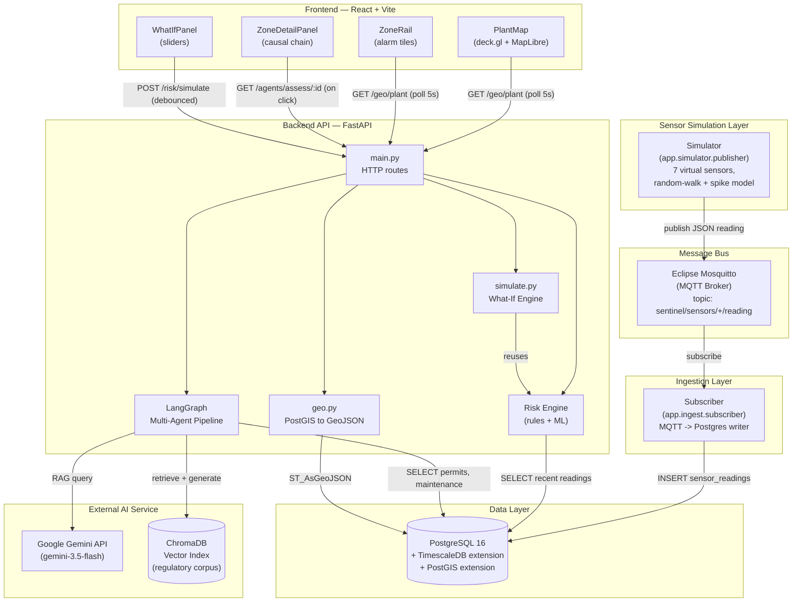

### 2.3 Major Modules and Their Responsibilities

| Module | Responsibility |
|---|---|
| `app.simulator` | Generates physically-plausible fake sensor readings and publishes them over MQTT |
| `app.ingest` | Subscribes to MQTT, persists readings into TimescaleDB, survives DB/broker restarts |
| `app.risk` | The hybrid rules + ML risk-scoring engine; also the what-if simulator (`simulate.py`) |
| `app.agents` | The LangGraph multi-agent pipeline that fuses sensor/permit/maintenance/compliance signals |
| `app.compliance` | The regulatory text corpus and its ChromaDB vector index |
| `app.geo` | Converts PostGIS geometry into GeoJSON for the map |
| `app.main` | The FastAPI application — HTTP routes only, no business logic lives here |
| `frontend/src/components` | React UI: map, zone rail, detail panel, what-if sliders |

### 2.4 How Data Flows Across the System (Summary)

```
Simulated sensor → MQTT → Ingest service → TimescaleDB
                                                  │
                                                  ▼
                          Frontend polls  ◄──  FastAPI  ◄── LangGraph agents
                          (map, cheap)          │              │
                                                 │              ├─ Permits table (Postgres)
                          Frontend clicks ◄──────┘              ├─ Maintenance table (Postgres)
                          (detail, expensive)                   └─ ChromaDB + Gemini (RAG)

What-if sliders → POST /risk/simulate → same risk engine (no DB write, hypothetical only)
```

---

## 3. Complete Project Workflow

### 3.1 Step-by-Step: From Page Load to Explained Risk Score

1. **Page load.** The React app mounts and immediately calls `GET /geo/plant`.
2. **Backend computes cheap scores.** For each of the 3 zones, the backend queries the last 60 seconds of sensor readings, computes a hybrid rules+ML score (no permits, no maintenance, no LLM — this is deliberately the *cheap* path), and returns each zone as a GeoJSON polygon tagged with `risk_score`/`risk_level`, plus each sensor as a GeoJSON point.
3. **Map renders.** deck.gl draws the polygons colored by risk level (steel gray = normal, through amber/orange/red) on a free dark basemap. The zone rail on the left shows the same data as alarm-style tiles. This poll repeats every 5 seconds — the "live" feel.
4. **User clicks a zone.** The frontend calls the expensive endpoint: `GET /agents/assess/{zone_id}`.
5. **Orchestrator validates the zone** and looks up its name.
6. **Two agents run in parallel:** Sensor Agent (re-runs the full hybrid engine) and Maintenance Agent (checks for overdue sensor calibrations).
7. **Permit Agent and Compliance Agent run next, in parallel** — both need the Sensor Agent's output. The Permit Agent queries active permits and cross-references them against whether sensors are currently elevated (a hazardous permit during an anomaly scores its full weight; during calm it scores a 0.1× baseline). The Compliance Agent builds a natural-language "situation" description, retrieves the 3 most semantically relevant regulatory excerpts from a vector database, and — only if there's actually something to comment on — asks Gemini to write a short, citation-grounded compliance note.
8. **Risk Synthesis Agent fuses everything**: sensor score is the base; permit and maintenance contribute additive bonuses; compliance contributes explanation only (no score change, to avoid double-counting with the permit agent).
9. **Response returned** to the frontend: one risk score, one risk level, and a full `contributing_signals` list — each entry traceable to a specific sensor reading, permit, maintenance record, or regulatory citation.
10. **Detail panel renders** the causal chain, plus (if the hazard is currently trending toward the critical threshold) a live countdown timer.
11. **User drags a what-if slider.** Every 250ms of inactivity, the frontend POSTs hypothetical sensor values to `/risk/simulate`, which runs those values through the *exact same* scoring function used in step 6 — proving the simulation isn't a frontend illusion.

### 3.2 Complete Workflow Diagram (Sequence)

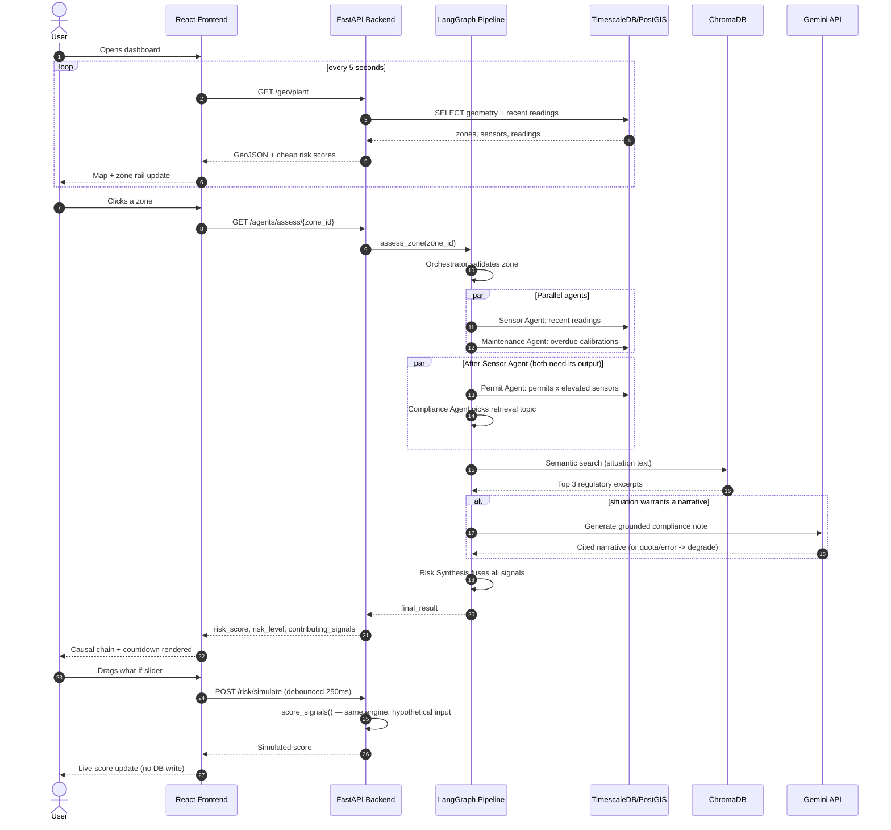

### 3.3 Decision-Making Process (Where the "Intelligence" Lives)

| Decision | Made by | Based on |
|---|---|---|
| Is this sensor reading anomalous? | Rules layer (`rules.py`) | z-score vs. type-specific baseline |
| Is this a *compound* risk pattern? | Both rules (explicit multiplier) and ML (learned from synthetic data) | Number of simultaneously-elevated sensor types |
| Does an active permit make this worse? | Permit Agent | Whether sensors are *currently* elevated in the same zone as the permit |
| Should I trust this sensor's reading? | Maintenance Agent | Calibration due-date |
| What regulation applies here? | Compliance Agent + Gemini | Semantic similarity search over real regulatory text, LLM only synthesizes from retrieved excerpts |

### 3.4 Final Output

A single JSON object (also rendered visually) containing: `risk_score` (0–100), `risk_level` (LOW/MEDIUM/HIGH/CRITICAL), a breakdown of how much each layer contributed, an optional time-to-critical countdown, and an ordered, human-readable list of every fact that contributed to the number.

---

## 4. Folder Structure

```
ETAI/                              (repository root)
├── README.md                      Setup/run instructions
├── CLAUDE_CONTEXT.md               Project history, milestone tracker, hard-won lessons
├── docker-compose.yml              Defines the db + mqtt containers
├── .env / .env.example             Secrets and config (never commit .env)
├── .gitignore
│
├── backend/
│   ├── requirements.txt            Pinned production dependencies
│   ├── requirements-dev.txt        Test-only dependencies (pytest, httpx)
│   ├── venv/                       Python virtual environment (not committed)
│   ├── db/
│   │   ├── init/                   SQL run automatically on first DB container start
│   │   │   ├── 01-extensions.sql   Enables TimescaleDB + PostGIS
│   │   │   ├── 02-schema.sql       zones, sensors, sensor_readings (hypertable)
│   │   │   ├── 03-seed.sql         3 zones + 7 sensors, seeded
│   │   │   ├── 04-agents-schema.sql permits, maintenance_records
│   │   │   └── 05-agents-seed.sql  Seeded permits + maintenance history
│   │   └── ...
│   ├── mqtt/
│   │   └── mosquitto.conf          MQTT broker config (anonymous access, local-only)
│   ├── tests/                      pytest suite (24 tests)
│   │   ├── conftest.py             Shared fixtures (FastAPI TestClient)
│   │   ├── test_rules.py           Rules-layer unit tests
│   │   ├── test_engine.py          Hybrid engine tests (the compound-risk property)
│   │   └── test_api.py             API integration tests
│   └── app/
│       ├── main.py                 FastAPI app + all HTTP routes
│       ├── db.py                   Shared Postgres connection helper
│       ├── geo.py                  PostGIS geometry -> GeoJSON conversion
│       │
│       ├── simulator/
│       │   ├── sensors.py          Sensor value simulation model
│       │   └── publisher.py        MQTT publisher process
│       │
│       ├── ingest/
│       │   └── subscriber.py       MQTT subscriber -> TimescaleDB writer
│       │
│       ├── risk/
│       │   ├── features.py         Shared feature engineering (train/serve parity)
│       │   ├── signals.py          Live signal extraction (z-scores, rates) from DB
│       │   ├── rules.py            Interpretable rule-based scorer
│       │   ├── train_model.py      Synthetic data generator + ML training
│       │   ├── engine.py           Hybrid fusion (rules + ML) — the core scorer
│       │   └── simulate.py         What-if simulation (reuses engine.score_signals)
│       │
│       ├── compliance/
│       │   ├── corpus.py           The regulatory text corpus (5 real, cited chunks)
│       │   ├── ingest.py           Builds the ChromaDB vector index
│       │   └── chroma_data/        Persisted vector index (gitignored, regenerable)
│       │
│       └── agents/
│           ├── state.py            Shared LangGraph state schema
│           ├── orchestrator.py     Validates zone, seeds shared context
│           ├── sensor_agent.py     Wraps the risk engine as a graph node
│           ├── permit_agent.py     Cross-references permits with sensor state
│           ├── maintenance_agent.py Calibration-overdue caveats
│           ├── compliance_agent.py RAG + Gemini narrative generation
│           ├── risk_synthesis_agent.py Final fusion into one explained score
│           └── graph.py            Assembles all nodes into the LangGraph pipeline
│
└── frontend/
    ├── package.json                 Dependencies + npm scripts
    ├── vite.config.js               Vite + Tailwind v4 plugin config
    ├── index.html                   HTML shell (favicon, root div)
    ├── scripts/
    │   └── screenshot.mjs           Playwright headless verification script
    └── src/
        ├── main.jsx                 React entry point, font imports
        ├── App.jsx                  Top-level layout + live polling
        ├── api.js                   API_BASE_URL constant
        ├── index.css                Design tokens (Tailwind v4 @theme block)
        ├── lib/
        │   └── risk.js              Shared risk-level color/label constants
        └── components/
            ├── StatusBar.jsx        Header: clock, link status, alarm summary
            ├── ZoneRail.jsx         Left sidebar: annunciator-style zone tiles
            ├── PlantMap.jsx         deck.gl + MapLibre geospatial map
            ├── MapLegend.jsx        Risk-level color legend overlay
            ├── ZoneDetailPanel.jsx  Right panel: full causal chain + countdown
            └── WhatIfPanel.jsx      Interactive sliders for hypothetical scoring
```

### 4.1 Why This Structure

- **`app/risk` vs `app/agents` are deliberately separate.** `risk/` is the *scoring engine* — pure functions, unit-testable, no knowledge of HTTP or LangGraph. `agents/` is the *orchestration layer* that wraps that engine (and others) into a multi-agent pipeline. This separation is why `sensor_agent.py` is only 9 lines: it doesn't reimplement scoring, it calls `app.risk.engine.score_zone`.
- **`db/init/` is numbered** because Postgres's official Docker image runs every `.sql` file in that directory in filename order, exactly once, on first container startup with an empty data volume. The numbers encode dependency order (extensions before schema, schema before seed data, base schema before agent-related tables).
- **`compliance/chroma_data/` is gitignored** — it's a build artifact regenerated by `python -m app.compliance.ingest`, the same reasoning as not committing `node_modules/`.

---

## 5. Frontend

### 5.1 Technologies Used

| Technology | Role |
|---|---|
| **React 19** | UI library — component-based, declarative rendering |
| **Vite 5** | Dev server + build tool (fast HMR, minimal config) |
| **Tailwind CSS v4** | Utility-first CSS, configured via a CSS-native `@theme` block (no separate config file) |
| **deck.gl 9** | WebGL-powered geospatial visualization (renders the zone polygons and sensor points) |
| **react-map-gl 8 (MapLibre variant) + MapLibre GL 5** | The interactive base map underneath deck.gl's layers |
| **@fontsource packages** | Self-hosted fonts (Barlow Condensed, IBM Plex Sans, IBM Plex Mono) — no runtime dependency on Google Fonts |
| **Playwright** | Headless-browser testing/verification (dev dependency, not shipped) |

### 5.2 UI Framework

Plain React with function components and hooks (`useState`, `useEffect`, `useCallback`, `useRef`, `useMemo`) — no additional framework (no Redux, no React Router). The app is a single screen with a persistent layout, so a router and a global state library would both be premature abstractions for what this app actually needs.

### 5.3 Routing

**None.** SENTINEL is a single-page dashboard; "navigation" is selecting a zone (a piece of local state, `selectedZoneId`, not a URL change).

### 5.4 State Management

State is deliberately kept local and lifted only as high as needed:

- `App.jsx` owns `plantData` (from the 5-second poll) and `selectedZoneId` — the two things multiple children need.
- `ZoneDetailPanel.jsx` owns its own `assessment`/`loading`/`error` state — nothing else needs it.
- `WhatIfPanel.jsx` owns its own slider `values`/`result`/`stale` state.

No global store (Redux/Zustand/Context) exists because no state is needed in more than two or three components at once — React's built-in `useState` + prop-passing is sufficient and simpler to reason about.

### 5.5 Components

| Component | Purpose |
|---|---|
| `App.jsx` | Top-level layout (header + rail + map + panel), owns the 5-second live poll |
| `StatusBar.jsx` | Header: SENTINEL wordmark, live IST clock, backend link status, plant-wide alarm summary chip |
| `ZoneRail.jsx` | Left sidebar — one "annunciator tile" per zone (name, score, progress bar, status word) |
| `PlantMap.jsx` | The deck.gl/MapLibre map: zone polygons colored by risk, sensor points, zone name labels, hover tooltips |
| `MapLegend.jsx` | Bottom-left color-key overlay (steel/amber/orange/red = normal/elevated/high/critical) |
| `ZoneDetailPanel.jsx` | Right sidebar — fetches and renders the full multi-agent assessment on zone selection |
| `WhatIfPanel.jsx` | Nested inside the detail panel — interactive sliders that call the live simulation endpoint |

### 5.6 API Communication

All communication is plain `fetch()` — no axios, no React Query. Every fetch call:
1. Checks `res.ok` before parsing JSON (a non-2xx response is treated as an error, not silently parsed).
2. Has an explicit `.catch()` path that sets user-visible error state (never a silent failure).

Two polling/request patterns exist:
- **Passive polling** (`App.jsx`, every 5s) — cheap, always running, drives the map/rail.
- **On-demand fetch** (`ZoneDetailPanel.jsx`, on click) and **debounced fetch** (`WhatIfPanel.jsx`, 250ms after the last slider move) — expensive, user-triggered only.

### 5.7 User Interactions

| Interaction | Effect |
|---|---|
| Click a zone (map polygon *or* rail tile) | Opens/toggles the detail panel, triggers `GET /agents/assess/{zone_id}` |
| Hover a zone or sensor on the map | Shows a styled tooltip (name + score, or sensor ID + type) |
| Drag a what-if slider | After 250ms of no further movement, POSTs the hypothetical values and updates the score live |
| Click "reset to live" | Snaps sliders back to the zone's actual current sensor values |
| Click "close" on the detail panel | Deselects the zone, panel reverts to its empty-state prompt |

### 5.8 Screens and Their Purpose

There is one screen (dashboard), composed of independently-purposed regions:

1. **Map region** — spatial "where is the danger" overview.
2. **Zone rail** — list/scan "which zone needs attention" overview.
3. **Detail panel** — deep "why is this zone flagged" explanation, plus the interactive simulator.

This three-region layout intentionally separates **overview** (map + rail, always-on, cheap) from **investigation** (detail panel, on-demand, expensive) — mirroring how a real control-room operator would actually work: scan for problems, then drill into the one that matters.

---

## 6. Backend

### 6.1 Framework Used

**FastAPI** (Python), served by **Uvicorn** (an ASGI server). FastAPI was chosen over Flask/Django because: it's async-native (matters for a system that will eventually hold many concurrent sensor streams), it auto-generates interactive API docs (`/docs`) from Python type hints, and it validates request/response shapes automatically via **Pydantic**.

### 6.2 Server Architecture

There is **no traditional "controller/service" layered architecture** with abstract interfaces — this is a deliberate, appropriately-scoped choice for a project this size. Instead:

- `main.py` contains only route definitions — each one is a thin adapter between an HTTP request and a call into `app.risk`, `app.agents`, or `app.geo`.
- Business logic lives in plain Python modules (`risk/`, `agents/`, `geo.py`) that have **zero FastAPI imports** — they can be (and are) unit-tested without spinning up a web server at all.

This is the standard "keep your business logic framework-agnostic" pattern, achieved here without needing a formal service-layer abstraction, because the logic naturally decomposed into a handful of well-named modules.

### 6.3 APIs

See [Section 10 — API Documentation](#10-api-documentation) for the complete reference. Summary: 8 endpoints, all JSON, no authentication (see [Section 16 — Security](#16-security) for why, and what a production version would add).

### 6.4 Database Interaction

Raw `psycopg2` (the standard PostgreSQL driver for Python) with hand-written SQL — **no ORM** (no SQLAlchemy, no Django ORM). This was a deliberate choice: the queries are simple enough (single-table selects, one join) that an ORM would add abstraction without saving meaningful code, and PostGIS-specific functions (`ST_AsGeoJSON`, `ST_Centroid`) are easier to reach for directly in raw SQL than through most ORMs' geometry support.

Every route that touches the database declares `conn = Depends(get_db)` — FastAPI's dependency injection system. `get_db()` (in `main.py`) is a generator: it opens a connection, `yield`s it to the route, and closes it in a `finally` block once the route returns — guaranteeing the connection is released even if the route raises an exception.

### 6.5 Business Logic

Concentrated in three modules, cleanly separated by concern:
- **`app.risk`** — "given sensor numbers, how risky is this?" (pure math/ML, no I/O concerns beyond reading sensor data)
- **`app.agents`** — "given a zone, gather every relevant fact and fuse them" (orchestration)
- **`app.compliance`** — "given a situation, what regulation applies?" (retrieval + generation)

### 6.6 Authentication

**None implemented.** This is a hackathon demo with no user accounts and no sensitive data beyond an API key. See [Section 16](#16-security) for what a production deployment would need.

### 6.7 Error Handling

Three deliberate layers, each added after a real failure was found during hardening (see [Section 18](#18-challenges-solved)):

1. **Database unreachable** → `get_db()` catches `psycopg2.OperationalError` and raises `HTTPException(503, "Database unavailable")` — a clean, machine-readable error instead of a raw stack trace.
2. **Unknown zone** → every route that takes a `zone_id` returns `404` with an explicit message rather than a `500` from an unhandled `KeyError`/`ValueError`.
3. **LLM (Gemini) unavailable/quota-exhausted/timed out** → the Compliance Agent *never* raises. It degrades to an explicit "narrative unavailable" signal, and the assessment as a whole still returns `200` — the failure of one non-critical dependency never fails the whole request.

### 6.8 Middleware

**CORS** (`CORSMiddleware`) — the frontend runs on a different origin (`localhost:5173`) than the API (`localhost:8000`); without this middleware, browsers block the frontend's `fetch()` calls entirely. Configured to allow exactly that one origin, all methods, all headers, with credentials.

### 6.9 Validation

Pydantic models validate request bodies automatically. `SimulateRequest` (in `main.py`) requires `zone_id: int` and `values: dict[str, float]` — a malformed body (wrong types, missing fields) is rejected with a `422` *before* any route code runs. The `/risk/simulate` route additionally validates that every key in `values` is a real sensor type (`gas`/`temperature`/`pressure`), returning `422` for anything else — and even legitimate values are clamped server-side to the published slider range, because an API must never trust a client to respect UI-level bounds.

### 6.10 Lifecycle of an API Request (Example: `GET /agents/assess/1`)

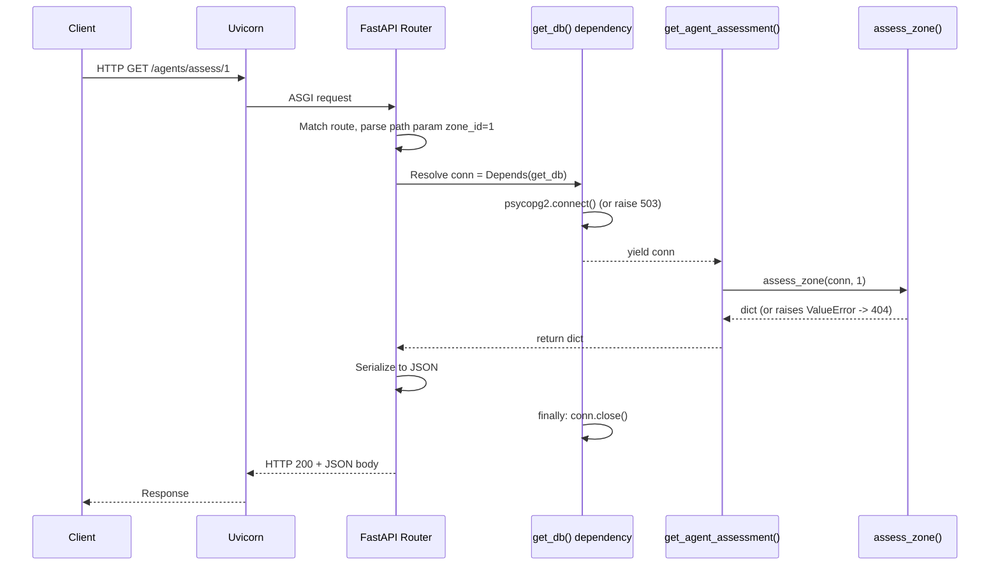

---

## 7. Database

### 7.1 Database Technology

**PostgreSQL 16**, extended with:
- **TimescaleDB** — turns a normal table into a *hypertable*: automatically partitioned by time into "chunks" behind the scenes, so queries like "last 60 seconds of readings" stay fast even as `sensor_readings` grows into millions of rows. Application code queries it exactly like a normal SQL table.
- **PostGIS** — adds geospatial types (`POLYGON`, `POINT`) and functions (`ST_AsGeoJSON`, `ST_Centroid`, `ST_MakeEnvelope`, `ST_MakePoint`) directly inside Postgres.

Both extensions run in the **same** database, via the `timescale/timescaledb-ha:pg16` Docker image — specifically chosen because it bundles both extensions compiled against the *same* Postgres binary (see [Section 18](#18-challenges-solved) for why the obvious-looking alternative silently fails).

### 7.2 Why This Database Was Chosen

| Alternative considered | Why rejected |
|---|---|
| Separate time-series DB (e.g. InfluxDB) + separate relational DB | Would prevent a single SQL query from joining sensor readings against permits/maintenance — exactly the cross-referencing this whole project is about |
| Plain float lat/lon columns instead of PostGIS | No spatial indexing, no polygon-containment queries — "is this point inside this zone" becomes application-code math instead of a database query |
| An ORM-managed schema | The schema is small (5 tables) and stable; raw SQL migrations in numbered files are simpler and more transparent for this scale |

### 7.3 Schema (Tables)

| Table | Purpose |
|---|---|
| `zones` | Physical areas of the plant — polygon boundary + name |
| `sensors` | One row per physical sensor — type, unit, point location, which zone it belongs to |
| `sensor_readings` | The time-series stream — a TimescaleDB hypertable (see below), narrow by design |
| `permits` | Work permits — type, validity window, status, which zone |
| `maintenance_records` | Calibration history per sensor |

### 7.4 Column Detail

**`zones`**
| Column | Type | Notes |
|---|---|---|
| `zone_id` | `SERIAL PRIMARY KEY` | |
| `name` | `TEXT NOT NULL` | |
| `boundary` | `GEOMETRY(Polygon, 4326)` | SRID 4326 = standard lat/lon (WGS 84) |

**`sensors`**
| Column | Type | Notes |
|---|---|---|
| `sensor_id` | `TEXT PRIMARY KEY` | e.g. `"gas-01"` |
| `zone_id` | `INTEGER REFERENCES zones(zone_id)` | Foreign key |
| `sensor_type` | `TEXT CHECK (IN gas/temperature/pressure)` | |
| `unit` | `TEXT NOT NULL` | `ppm` / `celsius` / `bar` |
| `location` | `GEOMETRY(Point, 4326)` | |

**`sensor_readings`** (TimescaleDB hypertable, partitioned on `ts`)
| Column | Type | Notes |
|---|---|---|
| `ts` | `TIMESTAMPTZ NOT NULL` | Reading timestamp |
| `sensor_id` | `TEXT REFERENCES sensors(sensor_id)` | |
| `value` | `DOUBLE PRECISION NOT NULL` | |

Deliberately narrow (3 columns) — this is the table that grows forever. Indexed on `(sensor_id, ts DESC)` for the "latest readings for this sensor" query pattern.

**`permits`**
| Column | Type | Notes |
|---|---|---|
| `permit_id` | `SERIAL PRIMARY KEY` | |
| `zone_id` | `INTEGER REFERENCES zones(zone_id)` | |
| `permit_type` | `TEXT CHECK (IN hot_work/confined_space/cold_work)` | |
| `status` | `TEXT CHECK (IN active/expired/cancelled)` | |
| `valid_from`, `valid_until` | `TIMESTAMPTZ` | Validity window |
| `description` | `TEXT` | |

**`maintenance_records`**
| Column | Type | Notes |
|---|---|---|
| `record_id` | `SERIAL PRIMARY KEY` | |
| `sensor_id` | `TEXT REFERENCES sensors(sensor_id)` | |
| `last_calibrated`, `next_due` | `TIMESTAMPTZ` | |

### 7.5 Relationships

- `sensors.zone_id → zones.zone_id` (many sensors per zone)
- `sensor_readings.sensor_id → sensors.sensor_id` (many readings per sensor)
- `permits.zone_id → zones.zone_id` (many permits per zone)
- `maintenance_records.sensor_id → sensors.sensor_id` (many records per sensor, over time)

### 7.6 Entity-Relationship Diagram

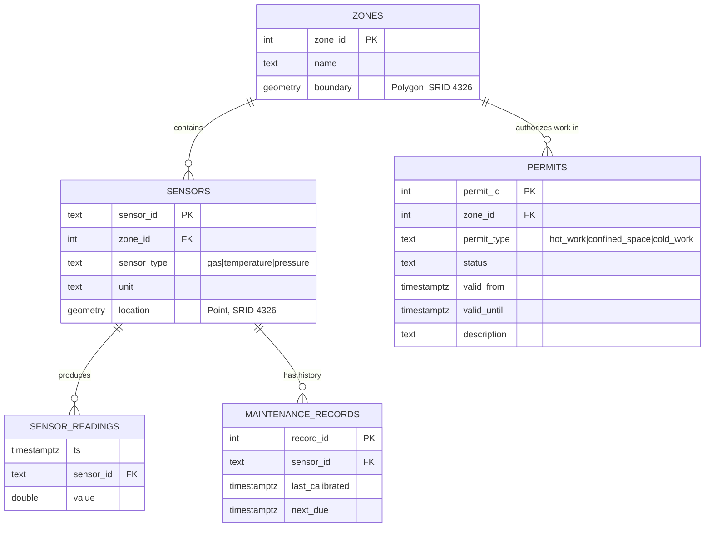

### 7.7 Indexes

- `sensor_readings (sensor_id, ts DESC)` — supports the "recent readings for this sensor" query that every risk calculation runs.
- TimescaleDB automatically maintains a time-based index on `ts` as part of hypertable chunking.

### 7.8 Data Storage Strategy

Reference data (zones, sensors, permits, maintenance) is small and read far more often than written — a handful of rows, loaded once at container startup via `db/init/*.sql`. Time-series data (`sensor_readings`) is write-heavy and unbounded — this is precisely the workload TimescaleDB's chunking is designed for. Keeping them as separate tables (rather than one denormalized table) means the hot write path (`sensor_readings`) stays narrow and fast regardless of how large the reference tables might eventually grow.

---

## 8. Technologies Used

For each technology: what it is, why chosen, what was rejected instead.

| Technology | What it is | Why chosen | Rejected alternative(s) |
|---|---|---|---|
| **Python** | General-purpose language | Best ecosystem for the AI/data-science libraries needed (scikit-learn, LangGraph, ChromaDB) | Node.js — would fragment the stack away from Python-first AI tooling |
| **FastAPI** | Async Python web framework | Auto docs, type-hint validation, async-native | Flask (no built-in validation/docs), Django (too heavyweight for a pure API) |
| **Uvicorn** | ASGI server | Runs FastAPI; supports async I/O | — |
| **PostgreSQL 16** | Relational database | Mature, extensible (via TimescaleDB/PostGIS), one system instead of several | — |
| **TimescaleDB** | Postgres extension for time-series | Fast partitioned queries over unbounded sensor data, stays in plain SQL | Standalone time-series DB (InfluxDB) — would prevent joining against permits/maintenance in one query |
| **PostGIS** | Postgres extension for geospatial data | Real polygon/point queries, not fake pixel math | Plain lat/lon floats — no spatial indexing or containment queries |
| **psycopg2** | Python Postgres driver | Simple, synchronous, sufficient for this query complexity | An ORM (SQLAlchemy) — unnecessary abstraction for ~10 straightforward queries |
| **paho-mqtt** | Python MQTT client | Standard library maintained by the Eclipse Foundation (same org as Mosquitto) | — |
| **Eclipse Mosquitto** | MQTT message broker | Free, open-source, the reference MQTT implementation | — |
| **scikit-learn** | ML library | `GradientBoostingClassifier` captures nonlinear sensor-interaction effects out of the box | Plain logistic regression (can't learn interactions without manual feature engineering), a neural net (needs far more data than 7 sensors provide) |
| **LangGraph** | Multi-agent orchestration framework | Explicit, visualizable graph of specialist agents; the right foundation once agents need LLM reasoning/conditional branching | A plain Python function pipeline (would work today, but doesn't scale to the planned Vision/Pattern agents) |
| **Google Gemini API** (`gemini-3.5-flash`) | LLM for the Compliance Agent's narrative generation | Explicit deviation from the original Claude-everywhere plan — the user's choice mid-build; strong cost/quality balance for a bounded RAG-synthesis task | Claude API (used by every *other* planned agent — this is a deliberate one-off substitution, not a migration) |
| **ChromaDB** | Vector database | Ships with a built-in local embedding model — zero external API calls to embed text, zero-config for a hackathon timeline | A hosted vector DB (Pinecone) — unnecessary network dependency and cost for a 5-document corpus |
| **React 19** | Frontend UI library | Component model fits a dashboard of independently-updating regions | — |
| **Vite** | Frontend build tool | Near-instant hot-reload, minimal config | Create React App (unmaintained, slower Webpack-based rebuilds) |
| **Tailwind CSS v4** | Utility-first CSS | Fast to build a consistent design-token system; v4's CSS-native `@theme` needs no separate config file | Hand-written CSS (slower to keep consistent across many components) |
| **deck.gl** | WebGL geospatial visualization | Composable layers (polygons, points, text) purpose-built for exactly this kind of map | Plotting sensor positions as plain HTML/CSS — no real geospatial rendering |
| **MapLibre GL** | Interactive base map renderer | Free, open-source fork of Mapbox GL (from before Mapbox went proprietary) — API-compatible, no signup/token required | Mapbox GL JS — requires an API token and has paid usage tiers |
| **CARTO basemap tiles** | Free map tile styles | No API key needed, dark style matches the design | Mapbox-hosted tiles (needs a token) |
| **Docker + Docker Compose** | Containerization | One-command reproducible environment for judges/teammates | Installing Postgres/MQTT natively — pollutes the host machine, harder to reproduce |
| **pytest** | Python testing framework | Standard, minimal-boilerplate | — |
| **Playwright** | Browser automation | Headless verification that the UI actually renders (not just "compiles without errors") | — |

---

## 9. Detailed Module Explanation

### 9.1 `app.simulator`

- **Purpose:** Generate physically-plausible fake sensor readings and publish them like real hardware would.
- **Inputs:** None (self-contained random-walk model).
- **Outputs:** MQTT messages on `sentinel/sensors/{sensor_id}/reading`, JSON payload `{sensor_id, sensor_type, unit, value, ts}`.
- **Internal logic:** Each sensor is modeled as a slow random walk (`SimulatedSensor.tick()`) — a "true" underlying value that drifts and is gently pulled back toward its resting baseline, plus a small probability each tick of an additive "spike" (simulating a leak/fault) that decays exponentially rather than vanishing instantly, plus independent measurement noise on top.
- **Dependencies:** `paho-mqtt` only.
- **Communicates with:** The MQTT broker (fire-and-forget publish; doesn't know or care who's listening).

### 9.2 `app.ingest`

- **Purpose:** Move readings from the message bus into permanent storage.
- **Inputs:** MQTT messages matching `sentinel/sensors/+/reading`.
- **Outputs:** Rows in `sensor_readings`.
- **Internal logic:** On each message, parses JSON and inserts a row. Owns a lazily-reconnecting Postgres connection — if the connection dies (e.g. a database restart), the next message triggers a reconnect-and-retry rather than crashing the whole service.
- **Dependencies:** `paho-mqtt`, `psycopg2`, `app.db`.
- **Communicates with:** MQTT broker (subscriber), Postgres (writer). Deliberately has *no* knowledge of the simulator or the API — pure decoupling via the broker and the database.

### 9.3 `app.risk` (the scoring engine)

- **Purpose:** Turn raw sensor numbers into an explained 0–100 risk score.
- **Inputs:** Either a `zone_id` (live path, queries the DB) or a hand-built signal dictionary (simulation path).
- **Outputs:** `{risk_score, risk_level, rule_score, ml_score, time_to_critical_seconds, contributing_signals}`.
- **Internal logic:** See [Section 12](#12-algorithms-and-logic) for the full algorithm.
- **Dependencies:** `scikit-learn`, `joblib`, `numpy`, `app.simulator.sensors` (for baseline/noise constants).
- **Key files:** `features.py` (shared vectorization — see the train/serve-skew discussion below), `signals.py` (DB → z-scores), `rules.py` (interpretable scorer), `train_model.py` (offline training), `engine.py` (fusion), `simulate.py` (what-if wrapper).

### 9.4 `app.agents` (the multi-agent pipeline)

- **Purpose:** Orchestrate multiple specialist reasoning steps into one fused, explained assessment.
- **Inputs:** `zone_id`.
- **Outputs:** `final_result` — the same shape as the risk engine's output, extended with `permit_bonus`, `maintenance_bonus`, and compliance narrative signals.
- **Internal logic:** A LangGraph `StateGraph` — see [Section 12.4](#124-the-multi-agent-graph-topology).
- **Dependencies:** `langgraph`, `app.risk`, `app.compliance`, Postgres (via the passed-in connection).

### 9.5 `app.compliance` (RAG)

- **Purpose:** Ground the Compliance Agent's LLM output in real regulatory text, not the model's training-data memory.
- **Inputs:** A natural-language "situation" string (e.g. `"active hot_work permit(s) and elevated gas sensor readings in an industrial zone"`).
- **Outputs:** The top-3 semantically closest excerpts from a 5-document corpus, each with a citation.
- **Internal logic:** ChromaDB's default embedding model (`all-MiniLM-L6-v2`, downloaded once, runs locally) converts both the corpus and the query into vectors; ChromaDB returns the nearest neighbors by vector distance.
- **Dependencies:** `chromadb`.

### 9.6 `app.geo`

- **Purpose:** Bridge PostGIS's native geometry format to the GeoJSON format every JS mapping library expects.
- **Inputs:** None beyond the DB connection.
- **Outputs:** Two `FeatureCollection`s (zones as polygons, sensors as points), zones tagged with cheap risk scores and label-anchor coordinates.
- **Internal logic:** `ST_AsGeoJSON()` converts geometry columns; `ST_Centroid()` computes each polygon's center for label placement.
- **Dependencies:** `app.risk.engine`, `app.risk.signals`.

---

## 10. API Documentation

Base URL (local dev): `http://localhost:8000`

### `GET /`
Liveness check.
**Response 200:**
```json
{"service": "SENTINEL", "status": "online"}
```

### `GET /health`
Health check (used by scripts/monitoring, not the frontend).
**Response 200:**
```json
{"status": "ok"}
```

### `GET /risk/zones`
Sensor-only hybrid risk score for **every** zone. No permits, no maintenance, no LLM calls — the cheap path.
**Response 200:** array of zone risk objects (see `/risk/zones/{zone_id}` shape).

### `GET /risk/zones/{zone_id}`
Sensor-only hybrid risk score for one zone.

| | |
|---|---|
| Method | `GET` |
| Path param | `zone_id: int` |
| Status codes | `200`, `404` (unknown zone), `503` (DB unavailable) |

**Example response (200):**
```json
{
  "zone_id": 1,
  "zone_name": "Compressor House",
  "risk_score": 18.1,
  "risk_level": "LOW",
  "rule_score": 0.0,
  "ml_score": 0.1,
  "time_to_critical_seconds": null,
  "contributing_signals": [
    {
      "source": "ml",
      "sensor_id": null,
      "sensor_type": null,
      "description": "ML model estimates a 0% probability this is a genuine compound-risk pattern...",
      "weight_contribution": 0.1
    }
  ]
}
```
If a zone has no recent sensor readings, `risk_score`/`rule_score`/`ml_score` are `null` and `risk_level` is `"UNKNOWN"`, with a `message` field explaining why.

### `GET /agents/assess/{zone_id}`
**The full multi-agent assessment** — sensor + ML + permit + maintenance + regulatory compliance, fused into one score.

| | |
|---|---|
| Method | `GET` |
| Path param | `zone_id: int` |
| Status codes | `200`, `404`, `503` |
| Internal execution | Builds and invokes the LangGraph pipeline (see [10.9](#internal-execution-flow-agentsassess)) |

**Example response (200), compound-risk scenario:**
```json
{
  "zone_id": 1,
  "zone_name": "Compressor House",
  "risk_score": 89.2,
  "risk_level": "CRITICAL",
  "sensor_score": 82.5,
  "permit_bonus": 2.5,
  "maintenance_bonus": 5,
  "time_to_critical_seconds": null,
  "contributing_signals": [
    {"source": "rule", "sensor_id": "gas-01", "sensor_type": "gas",
     "description": "gas sensor gas-01 reading 30.0 ppm is 27.5σ above its normal baseline",
     "weight_contribution": 35.0},
    {"source": "rule", "sensor_id": null, "sensor_type": null,
     "description": "Compound risk: 2 different sensor types (gas, temperature) elevated simultaneously...",
     "weight_contribution": "2.0x multiplier"},
    {"source": "ml", "sensor_id": null, "sensor_type": null,
     "description": "ML model estimates a 99% probability this is a genuine compound-risk pattern...",
     "weight_contribution": 99.2},
    {"source": "permit", "sensor_id": null, "sensor_type": null,
     "description": "Active hot_work permit in this zone (Welding repair on compressor housing) -- sensors in this zone are currently elevated -- ignition/exposure risk compounds",
     "weight_contribution": 25.0},
    {"source": "maintenance", "sensor_id": "gas-01", "sensor_type": null,
     "description": "Sensor gas-01 is overdue for calibration (was due 2026-05-22) -- treat its readings with reduced confidence",
     "weight_contribution": 0},
    {"source": "compliance", "sensor_id": null, "sensor_type": null,
     "description": "Under OISD-STD-114 gas-testing practice, hot work must not proceed if flammable gas readings approach the LEL...",
     "weight_contribution": 0,
     "citations": ["Common Indian industrial gas-testing practice (summary, referencing OISD-STD-114)", "..."]}
  ]
}
```

### `GET /geo/plant`
Zone polygons + sensor points as GeoJSON, for the map. Zones are tagged with the cheap risk score.

**Response 200:**
```json
{
  "zones": {
    "type": "FeatureCollection",
    "features": [
      {"type": "Feature", "geometry": {"type": "Polygon", "coordinates": [...]},
       "properties": {"zone_id": 1, "name": "Compressor House", "risk_score": 18.1,
                       "risk_level": "LOW", "label_lng": 77.501, "label_lat": 13.001}}
    ]
  },
  "sensors": {
    "type": "FeatureCollection",
    "features": [
      {"type": "Feature", "geometry": {"type": "Point", "coordinates": [77.5008, 13.0008]},
       "properties": {"sensor_id": "gas-01", "zone_id": 1, "sensor_type": "gas", "unit": "ppm"}}
    ]
  }
}
```

### `GET /risk/simulate/{zone_id}`
Returns the slider configuration for a zone's what-if simulator.

**Example response (200):**
```json
{
  "zone_id": 1,
  "controls": [
    {"sensor_type": "gas", "unit": "ppm", "baseline": 8.0, "current_value": 8.9,
     "min": 0.0, "max": 60.0, "step": 0.5},
    {"sensor_type": "pressure", "unit": "bar", "baseline": 4.5, "current_value": 4.5,
     "min": 0.0, "max": 10.0, "step": 0.1},
    {"sensor_type": "temperature", "unit": "celsius", "baseline": 36.0, "current_value": 35.5,
     "min": 20.0, "max": 60.0, "step": 0.5}
  ]
}
```

### `POST /risk/simulate`
Scores hypothetical sensor values through the **exact same** engine as live scoring.

| | |
|---|---|
| Method | `POST` |
| Request body | `{"zone_id": int, "values": {"gas": float, "temperature": float, "pressure": float}}` (any subset of sensor types) |
| Status codes | `200`, `404` (unknown zone), `422` (unknown sensor type or malformed body) |

**Example request:**
```json
{"zone_id": 1, "values": {"gas": 30, "temperature": 40, "pressure": 4.5}}
```
**Example response (200):** same shape as `/agents/assess`, plus `"simulated": true`, and `time_to_critical_seconds` is always `null` (a hypothetical steady-state value has no trend to project).

### Internal Execution Flow: `/agents/assess/{zone_id}`

```
1. FastAPI resolves the get_db() dependency -> psycopg2 connection (or 503)
2. Route calls app.agents.graph.assess_zone(conn, zone_id)
3. assess_zone() builds a fresh LangGraph StateGraph (build_graph(conn))
   and invokes it with {"zone_id": zone_id}
4. LangGraph runs the orchestrator node -> validates zone (or raises ValueError -> caught -> 404)
5. LangGraph runs sensor_agent and maintenance_agent as one concurrent
   "superstep" (they don't depend on each other)
6. LangGraph runs permit_agent and compliance_agent (both depend on
   sensor_agent's output) as the next superstep
7. LangGraph runs risk_synthesis_agent once ALL of {compliance, permit,
   maintenance} have completed
8. assess_zone() returns state["final_result"]
9. Route returns that dict; FastAPI serializes it to JSON
```

---

## 11. Data Flow

### 11.1 Where Data Originates

Two independent origins:
1. **Simulated telemetry** — the `app.simulator.publisher` process, standing in for real sensor hardware.
2. **Reference data** — permits, maintenance records, and the regulatory corpus, all seeded once (SQL init scripts / `corpus.py`) and treated as slowly-changing.

### 11.2 How It Moves Through the System

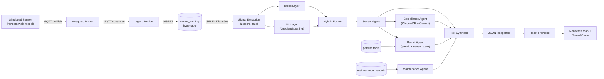

### 11.3 Processing Steps (Detail)

1. **Generation** — `SimulatedSensor.tick()` produces one float per sensor per tick (default every 3 seconds).
2. **Transport** — serialized to JSON, published to an MQTT topic.
3. **Persistence** — the ingest service writes one row per reading.
4. **Extraction** — `signals.py` queries the last 60 seconds, computes a z-score (how many standard deviations from normal) and a rate-of-change (also expressed in standard-deviations-per-second, so it's directly comparable across sensor types).
5. **Scoring** — the rules layer and ML layer independently score the same extracted signals; `engine.py` blends them 60/40.
6. **Fusion** — the LangGraph pipeline adds permit/maintenance/compliance context on top.
7. **Storage of the *result*** — none. Every score is computed fresh, on demand, from live data — there is no "risk_scores" table. This is a deliberate simplicity choice appropriate for a system this size (see [Section 19](#19-future-improvements) for what a production version would change).
8. **Retrieval** — the frontend fetches via HTTP.
9. **Visualization** — deck.gl renders geometry; React renders the causal chain as text.
10. **Final output** — pixels on screen, plus (in the what-if case) an interactive, live-recomputed number.

---

## 12. Algorithms and Logic

### 12.1 The Core Idea: z-Scores as a Universal Anomaly Measure

Every sensor type (gas in ppm, temperature in °C, pressure in bar) has a different natural scale — you can't compare "8 ppm" to "36 °C" directly. The fix is to express every reading as a **z-score**: how many standard deviations away from its known-normal baseline the current value is.

```
z = (current_value - baseline) / noise_stddev
```

A z-score of 0 means "exactly normal." A z-score of 3 means "three standard deviations above normal" — regardless of whether we're talking about gas, temperature, or pressure, a z-score of 3 means the same thing statistically. This is what lets the system compare and combine signals of totally different physical units.

The same trick is applied to **rate of change**: `rate_z` is expressed in "standard deviations per second," which means it is literally the derivative of `z` — `d(z)/dt`. This matters later for the time-to-critical projection.

### 12.2 The Rules Layer (`rules.py`) — Interpretable Scoring

**Step 1 — Elevated threshold.** A sensor counts as "elevated" once `z > 2.0` (`ELEVATED_Z_THRESHOLD`).

**Step 2 — Severity scaling.** Being *barely* elevated (z = 2.1) and being *wildly* elevated (z = 30) shouldn't score the same. A severity factor scales from 0 (at the threshold) to 1 (at threshold + 3.0, `SEVERITY_RANGE`) and stays capped at 1 beyond that:

```
severity = clamp((z - 2.0) / 3.0, 0, 1)
contribution = sensor_type_weight × severity
```

**Step 3 — Type weights.** `gas=35, pressure=30, temperature=20` — illustrative weights reflecting relative real-world danger (a gas leak is more acutely dangerous than a temperature drift), explicitly documented in code as not sourced from a real regulatory schedule.

**Step 4 — The compound multiplier (the core innovation).** After summing every individual sensor's contribution, a multiplier is applied based on how many *distinct sensor types* are simultaneously elevated in the zone:

| Condition | Multiplier |
|---|---|
| Only 0 or 1 sensor type elevated | 1.0× (no bonus) |
| 2+ distinct sensor types elevated | 1.5× |
| **All** sensor types present in the zone are elevated | 2.0× |

This is the literal mechanism that makes "gas alone" score modestly and "gas + temperature together" score disproportionately higher — not just additively higher, *multiplicatively* higher. This directly targets the hackathon rubric's "compound risk vs. single-sensor baseline" criterion.

**Step 5 — Clamp.** Final `rule_score = clamp(base_score × multiplier, 0, 100)`.

### 12.3 The ML Layer — Learned Pattern Detection

**Why ML in addition to rules?** The rules layer encodes patterns a human explicitly thought to write down. A `GradientBoostingClassifier` (an ensemble of decision trees, each correcting the previous ones' errors) can discover interaction effects between features without anyone hand-coding them — and tree-based splits are naturally good at exactly the kind of "if A is high AND B is high" logic that defines compound risk.

**Feature vector (8 numbers, fixed order):** `gas_z, gas_rate_z, temperature_z, temperature_rate_z, pressure_z, pressure_rate_z, n_present, n_elevated`. A sensor type not physically present in a zone defaults to `z=0, rate_z=0` ("at baseline"), so the same fixed-length vector works regardless of how many sensor types a zone has.

**Training data — synthetic, by necessity.** There is no historical incident data (near-misses are exactly what this system exists to prevent before they happen). Three labeled scenario classes are generated directly in feature space, 4,000 samples each:

| Class | Construction | Label |
|---|---|---|
| `normal` | All present types near baseline (`z ~ N(0,1)`) | 0 |
| `single_spike` | Exactly one type spikes (`z` uniform 2.5–15), the rest stay calm | 0 |
| `compound` | Two or more types spike simultaneously | 1 |

**Why `single_spike` is the important class.** It's the negative example that teaches the model "one weird sensor is not, by itself, a compound risk" — without it, the model could trivially learn "high z anywhere = danger" and never actually learn to detect *combinations*.

**Rising vs. plateaued hazards.** Each spike is either "rising" (`rate_z` uniform 0.5–2.5, a developing leak) or "plateaued" (`rate_z ~ N(0, 0.2)`, a leak that has stabilized at a dangerous level) — see [Section 18](#18-challenges-solved) for why this distinction was added after a real bug was found.

**Honest limitation.** The model reaches ≥99% accuracy on its held-out synthetic test set. This is worth being precise about in an interview: it mostly validates that the *pipeline* works correctly (features → labels → training), not that the model discovered some subtle hidden pattern — the `n_elevated` feature is close to a direct proxy for the label by construction, so this synthetic task is close to linearly separable. A production system would retrain on real historical/labeled incident data as it accumulates. This is exactly *why* the rules layer is weighted higher than the ML layer in the final blend — the interpretable layer is the trustworthy backbone while the ML layer's real-world generalization remains unproven.

### 12.4 Fusion: Combining Rules and ML

```
hybrid_score = 0.6 × rule_score + 0.4 × ml_score_probability
```

Rules get 60% weight, ML gets 40% — a deliberate safety-system design choice: an opaque model should never be the primary decision-maker in a system whose whole point is explainability. `risk_level` is then bucketed:

| Score range | Level |
|---|---|
| 0 – 29.9 | LOW |
| 30 – 59.9 | MEDIUM |
| 60 – 84.9 | HIGH |
| 85 – 100 | CRITICAL |

### 12.5 Time-to-Critical Projection

"Critical" is defined on the *same* statistical scale as "elevated" — `CRITICAL_Z = 6.0` — rather than a separate made-up absolute number per sensor type. Since `rate_z` is literally `dz/dt` (see 12.1), projecting forward is simple linear extrapolation:

```
seconds_to_critical = (CRITICAL_Z - current_z) / rate_z
```

...computed for every currently-rising sensor, and the *soonest* one wins. Only shown when the projection is positive and within 24 hours; never shown for simulated (steady-state) scenarios, since a slider position implies nothing about trend.

### 12.6 The Multi-Agent Graph Topology

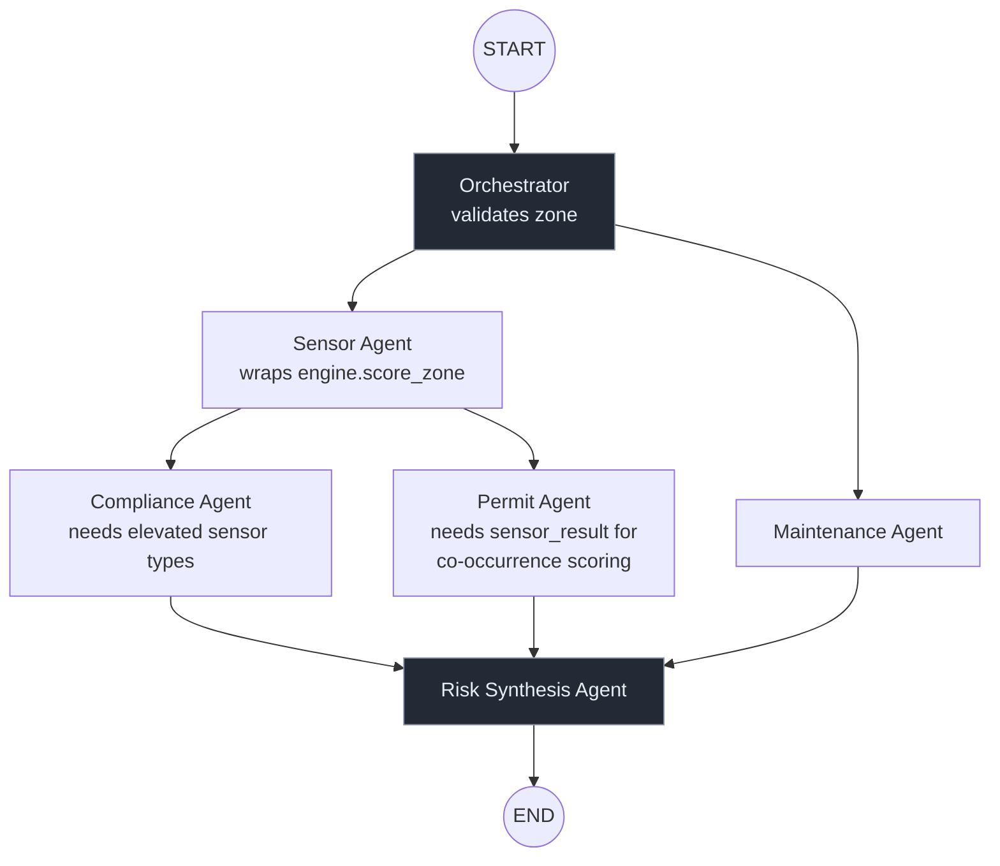

**Why this shape, not a simple sequential pipeline?** The Maintenance Agent depends only on `zone_id` (from the Orchestrator), so it runs **concurrently** with the Sensor Agent as one LangGraph "superstep." The Permit and Compliance Agents are different: both consume the Sensor Agent's output — the Permit Agent needs `sensor_result` for its permit-×-anomaly co-occurrence scoring, and the Compliance Agent needs to know *which sensor types are currently elevated* to decide what to retrieve — so both take their edge from the Sensor Agent and run one step later, in parallel with each other. Risk Synthesis has incoming edges from all three leaf nodes and — this is handled automatically by LangGraph's execution model — only runs once every one of them has completed. (The Permit Agent originally ran parallel to the Sensor Agent; see [Section 22](#22-code-explanation) for the dead-branch bug that topology caused and how it was found.)

### 12.7 Permit Agent Scoring Logic

The core insight: a permit's danger is **conditional on sensor state**, not intrinsic.

```
if sensor_elevated:
    contribution = permit_type_weight              # full weight
else:
    contribution = permit_type_weight × 0.1         # small informational baseline
```

Weights: `hot_work=25, confined_space=15, cold_work=5`, capped at a total bonus of 25. Verified behavior: the *same* active hot-work permit scores 2.5 points when the zone is calm and 25 points the instant a sensor in that zone becomes elevated — the permit itself never changed, only its context did.

### 12.8 Maintenance Agent Logic

A flat +5 bonus if *any* sensor in the zone has an overdue calibration (`next_due < now()`) — deliberately not scaled by how many sensors are overdue, because this is meant as a trust caveat on the explanation ("weigh this reading with skepticism"), not a scaling risk driver in its own right.

### 12.9 Compliance Agent (RAG) Logic

1. Build a "situation" string from the union of active permit types and currently-elevated sensor types.
2. **Cost-saving gate:** if the situation is completely calm (no permits, no elevated sensors), return immediately with no signal — **no LLM call is made**.
3. Otherwise, semantically retrieve the top-3 closest regulatory excerpts from ChromaDB.
4. Ask Gemini to write a 2–3 sentence note, explicitly instructed to only use facts present in the retrieved excerpts and to say so plainly if none are relevant (rather than stretching a citation to fit).
5. On any failure (quota exhausted, timeout, network error) at any step, degrade to an explicit "narrative unavailable" signal — the retrieved citations are still shown, but no text is fabricated.

---

## 13. External Services

| Service | What it does | How it integrates |
|---|---|---|
| **Google Gemini API** | Generates the compliance narrative text from retrieved regulatory excerpts | `google-genai` Python SDK; called only by `compliance_agent.py`; requires `GEMINI_API_KEY` in `.env` |
| **CARTO basemap tiles** | Serves the dark-styled map tiles under deck.gl's layers | A public style URL (`https://basemaps.cartocdn.com/gl/dark-matter-gl-style/style.json`), fetched directly by MapLibre in the browser; no API key |

No authentication providers, no cloud hosting services, and no other third-party APIs are used — deliberately, to keep the demo runnable entirely on a laptop plus two free-tier API dependencies (Gemini, and the one-time ChromaDB embedding-model download).

### 13.1 ChromaDB — Not Actually External

Worth calling out explicitly: **ChromaDB itself is not a hosted external service** — `chromadb.PersistentClient` runs in-process and persists to a local folder (`app/compliance/chroma_data/`). Its default embedding model (`all-MiniLM-L6-v2`) is downloaded once from the internet on first use and cached locally thereafter — a one-time network dependency, not a per-query one.

---

## 14. Project Execution Flow

### 14.1 What Happens When the Project Starts (Full Cold Boot)

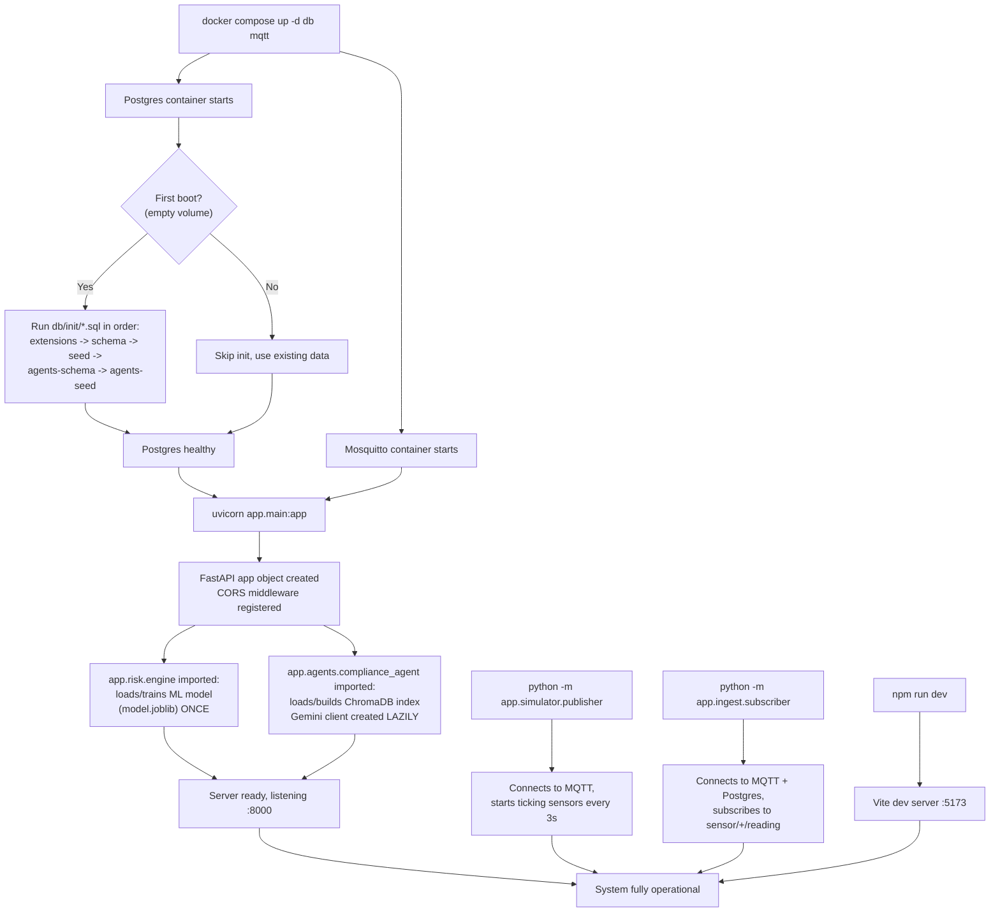

### 14.2 Initialization Order in Detail

1. **Database container** starts; on a genuinely first boot (empty Docker volume), Postgres's official entrypoint script runs every `.sql` file in `backend/db/init/` in filename order — this is why they're numbered.
2. **MQTT broker** starts independently (no dependency on Postgres).
3. **Backend process** starts. Two expensive one-time initializations happen at **import time**, not per-request:
   - `app.risk.engine` loads the trained model from `model.joblib`, or trains one on the fly (~1 second) if the file doesn't exist yet.
   - `app.agents.compliance_agent` opens (or builds) the ChromaDB collection. The Gemini client itself is **not** created here — it's created lazily on first actual use, specifically so a missing API key degrades one feature instead of crashing the whole server at startup.
4. **Simulator and ingest** are separate OS processes, started independently, communicating only through MQTT/Postgres — they can be stopped/restarted without affecting the API server.
5. **Frontend dev server** starts independently; it doesn't block on the backend being ready (its first poll simply fails gracefully and shows "backend: unreachable" until the API comes up).

### 14.3 Configuration Loading

All configuration is environment variables, loaded from a single `.env` file at the repository root via `python-dotenv`. Each module that needs env vars (`app.db`, `compliance_agent.py`) calls `load_dotenv()` independently with an explicit path resolved relative to its own file location — deliberately not relying on import order to guarantee the file is loaded, since that would be a fragile hidden dependency.

---

## 15. Performance Optimizations

| Optimization | Where | Why it matters |
|---|---|---|
| **Cheap vs. expensive endpoint split** | `/geo/plant` (poll every 5s) vs. `/agents/assess/{id}` (click only) | The map never triggers an LLM call; only user-initiated zone selection does — prevents a long demo session from silently racking up Gemini API costs |
| **Compliance Agent early-exit** | `compliance_agent.py` | A fully calm zone makes **zero** LLM calls — the gate check happens before any retrieval or generation |
| **Narrative caching** | `compliance_agent.py`, 10-minute TTL keyed by situation text | Free-tier Gemini quotas are small (~20 requests/day per model observed); identical situations (same zone, same permit, same elevated types) are extremely common in a demo, so caching conserves quota — verified to cut a repeat request from ~9.8s to ~0.2s |
| **Model fallback on quota exhaustion** | `compliance_agent.py` | Falls back to `gemini-3.1-flash-lite` (a separate daily quota) rather than failing outright |
| **Debounced what-if requests** | `WhatIfPanel.jsx`, 250ms | Dragging a slider fires many `onChange` events; only the value after 250ms of stillness triggers a network request |
| **Stale-response rejection** | `WhatIfPanel.jsx`, sequence counter | If requests resolve out of order (a slow earlier response arriving after a faster later one), the earlier one is discarded rather than incorrectly overwriting the UI |
| **TimescaleDB hypertable chunking** | `sensor_readings` | Keeps "last 60 seconds" queries fast regardless of how large the table grows |
| **Narrow hot-path table** | `sensor_readings` has only 3 columns | Minimizes write amplification on the highest-frequency table in the system |
| **ML model loaded once at import**, not per-request | `engine.py` | `joblib.load()` happens once at process startup, not on every `/risk/zones` call |
| **Self-hosted fonts** | `@fontsource` packages | No runtime network dependency on Google Fonts — matters for demo-venue wifi reliability |

### 15.1 Scalability Considerations (Honest Assessment)

This is a hackathon-scoped system, and several choices reflect that scope explicitly:
- **No caching layer for risk scores** (Redis, etc.) — every score is computed fresh. Fine at demo scale (3 zones, a handful of concurrent judges); would need to change for hundreds of zones or high request volume.
- **A fresh LangGraph is built on every `/agents/assess` call** (`build_graph(conn)` inside `assess_zone()`), rather than reused across requests — simple and correct, but rebuilding the graph object per-request is wasted work at scale.
- **In-memory narrative cache** is per-process and lost on restart — a production system would use Redis or similar for a shared, persistent cache across multiple backend instances.

---

## 16. Security

### 16.1 Authentication / Authorization

**None implemented** — appropriate for a hackathon demo with no user accounts or sensitive data, but explicitly **not** production-ready. A real deployment would need: user authentication (e.g. OAuth), role-based access control (who can view which plant's data), and audit logging of who viewed/acted on which alert.

### 16.2 Data Validation

- Pydantic models validate every request body's shape and types automatically (`SimulateRequest`).
- The `/risk/simulate` endpoint explicitly whitelists sensor type keys (`gas`/`temperature`/`pressure`) and rejects anything else with `422`.
- Simulated values are **clamped server-side** to the published slider range — the API never trusts a client to respect UI-level bounds, since a direct POST request bypasses the frontend entirely.

### 16.3 Input Sanitization

SQL queries use **parameterized queries exclusively** (`cur.execute(query, (param,))`) — never string interpolation into SQL — which is the standard, effective defense against SQL injection. Verified throughout `signals.py`, `permit_agent.py`, `maintenance_agent.py`, `compliance_agent.py`, `simulate.py`, `geo.py`.

### 16.4 API Protection

- **CORS** is scoped to exactly one origin (`http://localhost:5173`) — not a wildcard `*`.
- No rate limiting is implemented (a gap; see [Section 19](#19-future-improvements)).

### 16.5 Secrets Management

- `.env` (containing the database password and `GEMINI_API_KEY`) is git-ignored; `.env.example` (committed) documents required variables with placeholder values only.
- The database password is generated randomly (`openssl rand -hex 16`) rather than a guessable default, even for local development.

### 16.6 Known Gaps (Explicitly Acknowledged)

- No rate limiting — a malicious or buggy client could exhaust the Gemini quota by hammering `/agents/assess`.
- No HTTPS/TLS in local dev (fine on localhost; would be mandatory in any real deployment, typically terminated at a reverse proxy).
- No authentication means the API is fully open to anyone who can reach the port.

---

## 17. Deployment

### 17.1 Current Deployment Architecture (Local/Demo)

Everything runs on a single machine:

| Component | How it runs |
|---|---|
| Postgres + TimescaleDB + PostGIS | Docker container (`docker compose up -d db mqtt`) |
| MQTT broker | Docker container |
| Backend API | `uvicorn app.main:app --reload --port 8000` in a Python venv |
| Simulator | `python -m app.simulator.publisher`, separate process |
| Ingest | `python -m app.ingest.subscriber`, separate process |
| Frontend | `npm run dev` (Vite dev server, port 5173) |

Only the database and MQTT broker are containerized today; the backend, simulator, ingest, and frontend run directly on the host. Full containerization of all five processes into `docker-compose.yml` is the next planned step (see [Section 19](#19-future-improvements)).

### 17.2 Hosting

Not yet deployed to any cloud host — this is a local-only demo system by design, appropriate for a hackathon judging format where the presenter runs it live.

### 17.3 Environment Variables

| Variable | Purpose | Example |
|---|---|---|
| `POSTGRES_USER` | DB username | `sentinel` |
| `POSTGRES_PASSWORD` | DB password | (randomly generated) |
| `POSTGRES_DB` | Database name | `sentinel` |
| `POSTGRES_PORT` | Host port mapped to the container's 5432 | `55432` (deliberately non-default — see [18.2](#182-the-phantom-postgres)) |
| `GEMINI_API_KEY` | Google Gemini API key | (secret) |

### 17.4 Build Process

- **Backend:** no build step — Python runs interpreted. `pip install -r requirements.txt` installs pinned dependencies.
- **Frontend:** `npm run build` (Vite) would produce a static production bundle; not yet used since the demo runs the dev server directly.

### 17.5 CI/CD

**None configured.** The pytest suite (`backend/tests/`) exists and passes but is not yet wired into an automated pipeline — a manual `python -m pytest tests/` step today.

### 17.6 Production Workflow (What It Would Look Like)

Not built, but the shape is clear from the architecture: containerize all five processes, add a reverse proxy with TLS, move the frontend to a static build served from a CDN, add authentication, and move secrets to a proper secrets manager instead of a `.env` file.

---

## 18. Challenges Solved

This section is deliberately concrete — each entry is a real bug found and fixed during development, not a hypothetical.

### 18.1 The "Obvious" Docker Image Combination Silently Failed

**Attempted:** `FROM timescale/timescaledb:latest-pg16` + `apk add postgis` (Alpine's package manager).
**What went wrong:** Alpine's generic `postgis` package depends on and installs against **Alpine's own official Postgres package** — but TimescaleDB's image ships a **separately-built** Postgres binary under `/usr/local/`. The two installations never share a filesystem location, so `apk`-installed PostGIS files were invisible to the actual running Postgres, no matter which `pgXX` tag was tried.
**Fix:** Switched to `timescale/timescaledb-ha:pg16` — Timescale's own image built specifically to bundle many extensions (including PostGIS) compiled against the *same* Postgres binary. Verified by direct inspection (`find / -name postgis.control`) rather than assumption.

### 18.2 The Phantom Postgres

**What went wrong:** After a machine restart, every API test suddenly returned `503`/connection errors with `"role sentinel does not exist"` — even though the Docker container reported `healthy`. Root cause: a **native macOS Postgres installation** (Homebrew or Postgres.app) auto-starts on boot and silently binds `localhost:5432` — connections meant for the Docker container were reaching this unrelated database instead.
**Fix:** Moved the project's Postgres to a non-default port (`55432`) via `POSTGRES_PORT` in `.env`, eliminating the collision entirely rather than trying to prevent the native service from starting.

### 18.3 The ML Model's Blind Spot for Steady-State Hazards

**What went wrong:** The what-if simulator's compound scenario (gas + temperature both elevated) initially returned an ML probability near 0% — clearly wrong. Root cause: the synthetic training data's spike generator only ever produced *rising* anomalies (`rate_z` always positive), so the model implicitly learned "dangerous means actively rising" — a hazard that had **plateaued** (rate_z ≈ 0, exactly what a slider position implies) fell outside anything the model had ever seen.
**Fix:** `_spiked_signal()` in `train_model.py` now generates a mix of rising (60%) and plateaued (40%) spikes, with a wider z-score range to cover the full slider range. Retraining and retesting confirmed both rising and steady-state compound scenarios now correctly score >99% ML probability. A regression test (`test_compound_plateaued_fires_ml_too`) now guards against this specific bug reappearing.

### 18.4 A Silent LLM Crash Would Have Killed the Entire Backend

**What went wrong:** The original Compliance Agent read `os.environ["GEMINI_API_KEY"]` (a dictionary-style lookup that raises `KeyError` if missing) **at module import time** — meaning a machine without that key configured couldn't start the backend *at all*, not even for sensor monitoring, which has nothing to do with the LLM.
**Fix:** The Gemini client is now created lazily on first actual use, with `os.environ.get(...)` (never raises) and explicit failure-state tracking. A missing key now disables exactly one feature (the compliance narrative) and nothing else.

### 18.5 Free-Tier LLM Quota Exhaustion Mid-Demo

**What went wrong:** Live testing hit `429 RESOURCE_EXHAUSTED` from Gemini — the free tier allows roughly 20 requests/day per model. A judging session could exhaust this in minutes.
**Fix:** Three layers — (1) successful narratives are cached 10 minutes per situation, (2) `429` responses are never retried (a daily quota won't reset between attempts, so retrying just wastes time), (3) quota exhaustion on the primary model falls back to a second model with its own separate quota. Verified live: primary model's quota exhausted → fallback model produced a real narrative → the next identical request was served from cache in ~0.2 seconds (vs. ~9.8s for a fresh LLM call).

### 18.6 react-map-gl v8 / deck.gl v9 Rendering Nothing, With No Errors

**What went wrong:** An earlier map integration pattern (`<DeckGL><Map/></DeckGL>` with `Map` as a *child*) compiled cleanly, ran with zero console errors, and rendered a completely blank white canvas.
**Fix:** Current versions require the opposite composition — `Map` as the parent, with deck.gl attached via a `MapboxOverlay` control through the `useControl` hook (the overlay implements MapLibre's `IControl` interface, so it works with MapLibre despite the "Mapbox" name). Found and fixed via automated Playwright screenshots — the single most valuable verification tool added during hardening, since "no console errors" and "actually renders" turned out to be two different claims.

### 18.7 A Colorblind-Unsafe Alarm Palette

**What went wrong:** The initial amber (`#eab308`)/orange (`#f97316`) pair for MEDIUM/HIGH alarm states was assumed to be distinguishable, but a computed colorblindness-separation check (deuteranopia simulation) showed a marginal ΔE of only 11.7 — below a safe threshold for a life-safety-relevant color code.
**Fix:** Swapped MEDIUM to a lighter yellow (`#facc15`), re-validated to ΔE 20.5 — a clean, comfortable pass. This was caught by *computing* the check rather than eyeballing it, which is the whole point of validating a safety-system color palette programmatically.

---

## 19. Future Improvements

| Area | Improvement | Why it matters |
|---|---|---|
| **Deployment** | Full one-command `docker-compose up` (containerize backend, simulator, ingest, frontend) | Currently only DB+MQTT are containerized; full containerization is the last planned milestone |
| **Vision Agent** | Process simulated CCTV frames for zone occupancy | Designed in the original architecture, not yet built — needs a simulated video/frame data source |
| **Pattern Agent** | Query a Neo4j knowledge graph of historical near-misses | Designed in the original architecture; Neo4j setup has no assigned milestone yet — a genuine open gap |
| **Real regulatory corpus** | Replace the 5-document illustrative sample with a licensed, complete OISD/DGMS/Factories Act corpus and a real document-ingestion pipeline | The current corpus proves the RAG *pattern* works, not that it's a complete compliance reference |
| **Model retraining on real data** | Replace/augment synthetic training data with real historical incident data as it accumulates | Directly addresses the "honest limitation" in [12.3](#123-the-ml-layer--learned-pattern-detection) |
| **Authentication & RBAC** | User accounts, role-based access per plant/zone | Required before this could handle real operational data |
| **Rate limiting** | Protect `/agents/assess` from quota-exhausting abuse | Currently unprotected |
| **Persistent risk-score history** | Store computed scores over time (not just raw sensor readings) | Enables trend dashboards, alert audit trails, and "how did we do" retrospectives |
| **Shared/distributed cache** | Redis for the narrative cache (currently in-process, per-instance) | Needed the moment there's more than one backend instance |
| **CI/CD pipeline** | Automate the existing pytest suite on every push | Tests exist; they're not yet gating merges |

---

## 20. Interview Preparation

### 20.1 The 2-Minute Explanation

"SENTINEL is an industrial safety platform that detects **compound risk** — dangerous situations that emerge from combining individually-normal signals, like a gas sensor trending up *while* a welding permit is active in the same zone. Most systems would flag each of those separately, or not at all. SENTINEL fuses sensor data, work permits, and maintenance records through a multi-agent pipeline built on LangGraph, scores risk with a hybrid system — interpretable rules plus a gradient-boosted ML model — and explains every score with a full causal chain traceable back to real data, including a citation-grounded compliance narrative generated through retrieval-augmented generation over real regulatory text. There's also a live what-if simulator: you can drag a slider to raise a hypothetical gas reading and watch the score stay low, then add a second sensor type and watch it jump to critical — live, through the actual production scoring engine, not a fake demo number."

### 20.2 The 5-Minute Explanation

Expand the 2-minute version with: the sensor-simulation-over-MQTT architecture (mirrors real IoT deployments), the specific compound-risk math (the 1.5×/2.0× multiplier and why it's on top of, not instead of, the ML layer), the deliberate cheap/expensive endpoint split for cost control, and 2–3 of the hardening stories from [Section 18](#18-challenges-solved) (the ML blind spot is the strongest one — it shows real debugging, not just feature-building).

### 20.3 Technical Explanation (for an engineering audience)

Lead with the architecture diagram ([2.2](#22-system-architecture-diagram)): MQTT-decoupled sensor simulation → TimescaleDB/PostGIS → a LangGraph multi-agent pipeline with real parallel/sequential dependencies (not a linear script) → hybrid rules+ML fusion → RAG-grounded LLM narrative → React/deck.gl frontend with a cheap-poll/expensive-click split. Emphasize: train/serve parity (`features.py` shared by training and inference — the single most common way real ML systems silently break), the honest ML-accuracy caveat, and the graceful-degradation design (every external dependency — DB, LLM — has an explicit failure path that keeps the rest of the system working).

### 20.4 Non-Technical Explanation

"Imagine a factory floor with sensors, permits, and maintenance logs that never talk to each other. A supervisor might see a slightly-high gas reading and think nothing of it, not knowing there's also a welding job authorized in that exact spot right now. SENTINEL connects all three systems and raises an alarm specifically when that dangerous *combination* happens — and explains exactly why, in plain language, instead of just showing a red number."

### 20.5 Frequently Asked Interview Questions and Strong Answers

**Q: Why not just set a fixed threshold per sensor?**
A: Because the whole point is combinations. A gas reading that's individually below any reasonable alarm threshold can still be part of a dangerous pattern if it coincides with an active hot-work permit or another elevated sensor. A fixed per-sensor threshold, by definition, can never detect that — it only ever looks at one number in isolation. The multiplier logic explicitly rewards *simultaneous* elevation beyond what a linear sum would.

**Q: Your ML model gets 99%+ accuracy — isn't that suspicious?**
A: Yes, and I'd flag it myself before you asked. It's trained and tested on synthetic data drawn from the same generator, so the near-perfect score mostly proves the pipeline is wired correctly, not that the model has learned something profound — one of my engineered features (`n_elevated`) is close to a direct proxy for the label by construction. That's exactly why the rules layer, not the ML layer, gets the larger weight (60/40) in the final score — rules are the trustworthy, auditable backbone; ML is the pattern-detection layer whose real-world generalization is still unproven until it sees real incident data.

**Q: How do you know your what-if simulator isn't just faking the numbers?**
A: Because it calls the identical scoring function as live data — `engine.score_signals()` — there's no separate "simulation logic." I actually found and fixed a real bug this way: the first version of the simulator surfaced a case where a steady-state (non-rising) compound hazard scored 0% on the ML layer, because my synthetic training data only ever generated rising spikes. That's a legitimate example of the simulator acting as a testing tool, not just a demo gimmick.

**Q: What happens if the LLM API is down during your demo?**
A: The system degrades gracefully at three levels — a missing API key disables only the narrative feature at startup, a failed/timed-out call falls back to a second model with a separate quota, and if everything fails, it returns an explicit "narrative unavailable" signal with the retrieved citations still shown, rather than fabricating text or crashing the request. I found the quota-exhaustion failure mode by actually hitting it during testing, not by guessing it might happen.

**Q: Why LangGraph instead of just calling functions in sequence?**
A: For exactly what today's agents do — deterministic, fast, no LLM reasoning involved in most of them — a plain function pipeline would honestly work fine. LangGraph earns its complexity for two reasons: it gives an explicit, visualizable dependency graph (Sensor + Maintenance run in parallel; Permit and Compliance both depend on Sensor's output; Synthesis waits for everyone) that's self-documenting, and it's the right foundation for when agents need actual LLM-driven conditional branching — which the Compliance Agent already has, and which planned agents (Vision, Pattern) will need more of.

**Q: What's the biggest thing you'd change with more time?**
A: Two things: a real, licensed regulatory corpus (the current one is 5 illustrative excerpts, honestly labeled as such, sized for the demo's permit types — not a production compliance database), and retraining the ML model on real incident data instead of synthetic scenarios, since that's the actual unproven part of the system.

### 20.6 Likely Follow-Up Questions

- "Walk me through what happens, end to end, when I click a zone." → See [Section 21](#21-complete-end-to-end-walkthrough).
- "How do you prevent the compound multiplier from just being 'more sensors = more score' in disguise?" → Because the multiplier only applies when *distinct sensor types* cross the elevation threshold — a single sensor spiking arbitrarily high never triggers it (severity is capped per-sensor); it specifically requires independent axes of danger.
- "Why is the compliance agent using Gemini and not Claude like the rest of the plan?" → Explicit, documented, mid-build decision by the project owner — every other planned agent still assumes Claude; this is a deliberate one-off substitution for one RAG-narrative-generation call, not a platform migration.

---

## 21. Complete End-to-End Walkthrough

**Scenario: A judge opens the dashboard and investigates a rising gas reading.**

1. **Page load.** Browser requests `http://localhost:5173`. Vite serves `index.html`, which loads `main.jsx`. React mounts `App.jsx`.
2. **First data fetch.** `App.jsx`'s `useEffect` immediately calls `GET http://localhost:8000/geo/plant`.
3. **Backend processes the request.** FastAPI resolves `get_db()` → opens a psycopg2 connection. `get_plant_geojson(conn)` runs: queries `zones`/`sensors` geometry via `ST_AsGeoJSON`, then for each of the 3 zones calls `engine.score_zone()` — which itself queries `sensor_readings` for the last 60 seconds, computes z-scores, runs the rules layer and the ML model, and blends them.
4. **Response returns.** Three zone polygons (with risk scores baked in) and seven sensor points, as GeoJSON.
5. **Rendering.** `PlantMap.jsx` builds a `GeoJsonLayer` for zones (fill color computed per-feature from `risk_level`) and one for sensors, plus a `TextLayer` for zone name labels, and hands them to deck.gl's `MapboxOverlay`, which composites them onto the MapLibre basemap. `ZoneRail.jsx` renders the same zones as alarm tiles with animated progress bars.
6. **The judge notices "Compressor House" reading 84.6, colored orange.** They click its polygon on the map (or its tile in the rail — both call the same `onZoneClick` handler).
7. **Detail fetch.** `ZoneDetailPanel.jsx`'s `useEffect` fires `GET http://localhost:8000/agents/assess/1`.
8. **The LangGraph pipeline runs** (see [10.9](#internal-execution-flow-agentsassess) for the exact sequence): Orchestrator validates zone 1 exists → Sensor and Maintenance agents run concurrently → Sensor Agent finds gas-01 reading 27.5σ above baseline → Permit and Compliance agents run next, both consuming the Sensor Agent's output. The Permit Agent sees the active hot-work permit co-occurring with elevated readings and scores its full weight (+25 — during calm readings the same permit scores only +2.5). The Compliance Agent sees `gas` in the elevated-types set, builds the situation string `"active hot_work permit(s) and elevated gas sensor readings in an industrial zone"`, retrieves the top-3 regulatory excerpts from ChromaDB (the gas-testing/LEL excerpt ranks first), and — since there's genuinely something to say — calls Gemini, which returns a short note citing that excerpt and correctly *declining* to cite the irrelevant confined-space excerpts also retrieved → Risk Synthesis fuses: sensor score 82.5 (base) + permit bonus 25 + maintenance bonus 5 (gas-01 is overdue for calibration) = final score, capped at 100.
9. **Response renders.** The panel shows the score in large mono numerals, a color-coded level badge, a live-ticking countdown (if the trend is currently rising toward critical), and the full ordered list of contributing signals — each one a real sentence tied to a real fact.
10. **The judge drags the "gas" slider down, then back up past 30, then also drags "temperature" up.** Each change resets a 250ms debounce timer. After the timer fires, `WhatIfPanel.jsx` POSTs `{"zone_id": 1, "values": {"gas": 30, "temperature": 40, "pressure": 4.5}}` to `/risk/simulate`.
11. **Backend scores the hypothetical.** `simulate_zone()` builds a fake `per_sensor`/`by_type` structure from the posted values (clamped to valid ranges, `rate_z` forced to 0), and calls `engine.score_signals()` — the **exact same function** step 8's Sensor Agent called. With gas alone: ~21, LOW. With gas + temperature: score jumps to ~89, CRITICAL, and a "compound" badge appears — because the 2.0× rule multiplier and the ML model both fire simultaneously.
12. **The judge sees the number update live**, with no page reload, no fake animation — a real network round-trip to the real scoring engine, in well under a second.

---

## 22. Code Explanation

This section walks through the most important functions block-by-block. (Full source is in the repository; this covers the logic that matters most for understanding *why* the system behaves as it does.)

### 22.1 `app/risk/rules.py` — `_severity_factor()` and `score_zone()`

```python
def _severity_factor(z: float) -> float:
    if z <= ELEVATED_Z_THRESHOLD:
        return 0.0
    return min(1.0, (z - ELEVATED_Z_THRESHOLD) / SEVERITY_RANGE)
```
- **Purpose:** Converts a raw z-score into a 0–1 "how bad is this" scale.
- **Inputs:** `z` (the sensor's current standard-deviations-from-normal).
- **Output:** `0.0` if not elevated; otherwise linearly ramps to `1.0` over the next 3 standard deviations, then stays capped.
- **Why it exists:** Without this, a barely-elevated sensor (z=2.1) and a wildly-elevated one (z=30) would contribute the same weight — this makes the score proportional to severity, not just presence.

```python
def score_zone(per_sensor: list[dict], by_type: dict) -> dict:
    contributing_signals = []
    base_score = 0.0
    for sensor in per_sensor:
        severity = _severity_factor(sensor["z"])
        if severity <= 0:
            continue
        weight = SENSOR_TYPE_WEIGHT[sensor["sensor_type"]]
        contribution = weight * severity
        base_score += contribution
        ...  # build a human-readable signal description
```
- **Purpose:** The main rules-layer entry point.
- **Inputs:** `per_sensor` (one entry per physical sensor, with its z-score/rate), `by_type` (worst-per-type aggregation).
- **Logic:** Loops every sensor; skips non-elevated ones; accumulates weighted severity; separately builds a plain-English `description` string for each contributing sensor.
- **Then:** counts distinct elevated *types* (not sensors), applies the 1.5×/2.0× multiplier, appends a special "Compound risk" signal if the multiplier fired.
- **Output:** `{"rule_score": float 0-100, "contributing_signals": [...]}`.
- **Interacts with:** Called by `engine.score_signals()`; consumes `features.ELEVATED_Z_THRESHOLD`.

### 22.2 `app/risk/engine.py` — `score_signals()`

```python
def score_signals(per_sensor: list[dict], by_type: dict) -> dict:
    rule_result = rules.score_zone(per_sensor, by_type)
    feature_vector = build_feature_vector(by_type)
    model = _model_bundle["model"]
    ml_score = model.predict_proba([feature_vector])[0][1] * 100
    hybrid_score = RULE_WEIGHT * rule_result["rule_score"] + ML_WEIGHT * ml_score
    ...
```
- **Purpose:** The single fusion point — the "one code path" both live scoring and what-if simulation share.
- **Inputs:** Same `per_sensor`/`by_type` shape as the rules layer.
- **Logic:** Runs the rules layer; separately builds the 8-feature vector and asks the trained model for `predict_proba` — the probability of the "compound" class, expressed as a percentage; blends the two 60/40; builds the ML-layer's own explanation sentence naming its top-2 most influential features globally.
- **Output:** The complete scoring result dict (score, level, sub-scores, time-to-critical, all contributing signals).
- **Why it's separated from `score_zone()`:** `score_zone()` additionally does a *database query* to get live signals; `score_signals()` takes signals as plain arguments, so it works identically whether those signals came from the database (live) or were hand-constructed from slider positions (simulation) — this is what makes the what-if simulator honest rather than a lookalike reimplementation.

### 22.3 `app/agents/graph.py` — `build_graph()`

```python
def build_graph(conn):
    g = StateGraph(AgentState)
    g.add_node("orchestrator", make_orchestrator(conn))
    g.add_node("sensor_agent", make_sensor_agent(conn))
    ...
    g.add_edge(START, "orchestrator")
    g.add_edge("orchestrator", "sensor_agent")
    g.add_edge("orchestrator", "maintenance_agent")
    g.add_edge("sensor_agent", "permit_agent")
    g.add_edge("sensor_agent", "compliance_agent")
    g.add_edge("compliance_agent", "risk_synthesis")
    g.add_edge("permit_agent", "risk_synthesis")
    g.add_edge("maintenance_agent", "risk_synthesis")
    g.add_edge("risk_synthesis", END)
    return g.compile()
```
- **Purpose:** Declares the entire multi-agent dependency graph.
- **Key detail:** Every agent factory (`make_orchestrator(conn)`, etc.) is a **closure over the database connection** — this is how each node gets access to Postgres without putting a raw connection object into LangGraph's state (which is meant to hold serializable data, not live resources).
- **Why the specific edges matter:** LangGraph determines parallelism purely from the edge structure — nodes fed only by `orchestrator` run concurrently as one "superstep"; `risk_synthesis` automatically waits for all of its inbound edges to resolve before running. No manual thread/async management was written — it falls out of declaring the graph correctly.
- **A bug this structure hid (and how it was found):** the Permit Agent originally hung off `orchestrator`, in parallel with the Sensor Agent — but it reads `state["sensor_result"]` for its co-occurrence check, which was always empty at that point, so every permit silently scored the 0.1× baseline. The dead branch was discovered from the *frontend*: the causal-chain card said "no elevated sensor readings right now" directly beneath a 10.7σ sensor card. The rule that falls out: **an agent that reads another agent's output must take its edge from that agent, not from the orchestrator** — which is why `permit_agent` and `compliance_agent` both now hang off `sensor_agent`.

### 22.4 `app/agents/compliance_agent.py` — `_generate_narrative()`

```python
def _generate_narrative(client, situation, prompt):
    cached = _narrative_cache.get(situation)
    if cached and time.monotonic() - cached[0] < CACHE_TTL_SECONDS:
        return cached[1], ""
    for model in MODELS:
        for attempt in (1, 2):
            try:
                response = client.models.generate_content(model=model, contents=prompt, ...)
                description = (response.text or "").strip()
                if not description:
                    raise ValueError("empty LLM response")
                _narrative_cache[situation] = (time.monotonic(), description)
                return description, ""
            except genai_errors.ClientError as exc:
                if getattr(exc, "code", None) == 429:
                    reason = "LLM daily quota exhausted"
                    break  # try next model, not another attempt on this one
                ...
```
- **Purpose:** The resilience core of the whole compliance feature.
- **Logic:** Cache check first (free). Then iterates `MODELS = ["gemini-3.5-flash", "gemini-3.1-flash-lite"]`; for each model, up to 2 attempts — but a `429` (quota exhausted) breaks out of the retry loop immediately rather than wasting a second attempt (a daily quota won't reset in milliseconds) and moves to the *next model* instead, which has its own separate quota.
- **Output:** `(narrative_text_or_None, failure_reason_string)`.
- **Why this shape:** Every failure path returns a reason string rather than raising — the caller (`compliance_agent()`) always has enough information to build a meaningful degraded signal instead of a generic error.

### 22.5 `frontend/src/components/WhatIfPanel.jsx` — Debounce and Staleness Logic

```javascript
const handleChange = (sensorType, raw) => {
  const next = { ...values, [sensorType]: Number(raw) };
  setValues(next);
  clearTimeout(debounceTimer.current);
  debounceTimer.current = setTimeout(() => runSimulation(zoneId, next), DEBOUNCE_MS);
};
```
- **Purpose:** Update the visible slider position instantly (good UX — no lag on the handle itself) while deferring the expensive network call.
- **Logic:** Every keystroke/drag cancels the previous pending timer and starts a new one; only the value after 250ms of no further movement actually fires a request.

```javascript
const runSimulation = useCallback((zone, vals) => {
  const seq = ++requestSeq.current;
  fetch(...).then(res => ...).then(data => {
    if (seq === requestSeq.current) { setResult(data); setStale(false); }
  }).catch(() => { if (seq === requestSeq.current) setStale(true); });
}, []);
```
- **Purpose:** Prevents a race condition where an old, slow response overwrites a newer, faster one.
- **Logic:** Each call increments a shared counter and captures its own value (`seq`). When the response arrives, it only applies its result if `seq` still matches the *latest* counter value — meaning if the user dragged the slider three more times while the first request was in flight, only the response to the *last* request wins.

---

## 23. Visual Diagrams

The most important diagrams already appear inline where they're most useful (architecture in [§2.2](#22-system-architecture-diagram), sequence in [§3.2](#32-complete-workflow-diagram-sequence), request lifecycle in [§6.10](#610-lifecycle-of-an-api-request-example-get-agentsassess1), ER diagram in [§7.6](#76-entity-relationship-diagram), data flow in [§11.2](#112-how-it-moves-through-the-system), agent graph in [§12.6](#126-the-multi-agent-graph-topology)). This section adds the remaining requested views.

### 23.1 Component Diagram (Frontend)

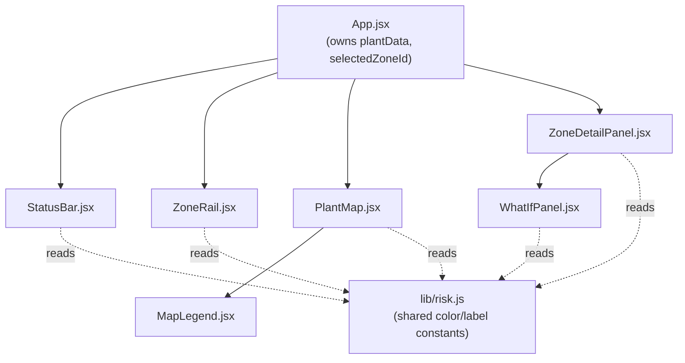

### 23.2 Deployment Diagram (Current, Local)

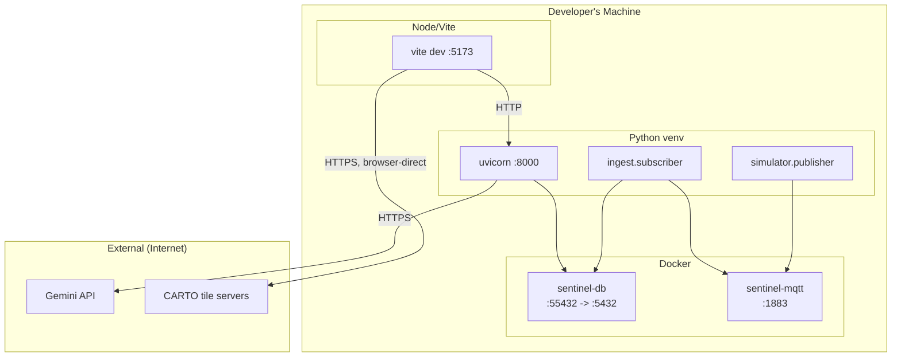

### 23.3 User Journey Diagram

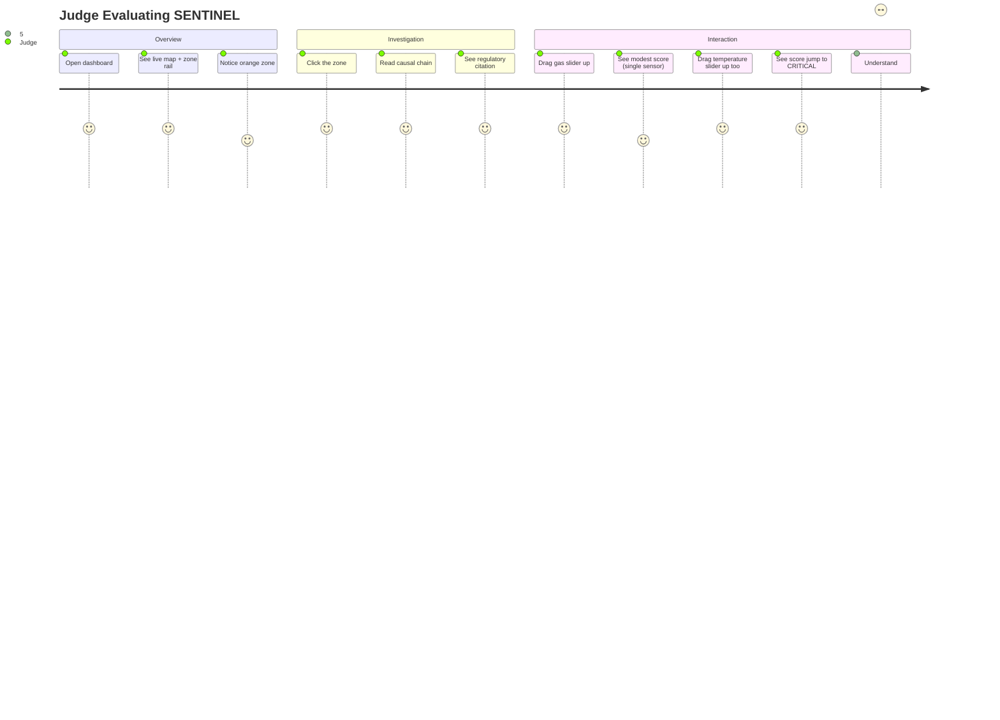

### 23.4 Module Dependency Diagram (Backend)

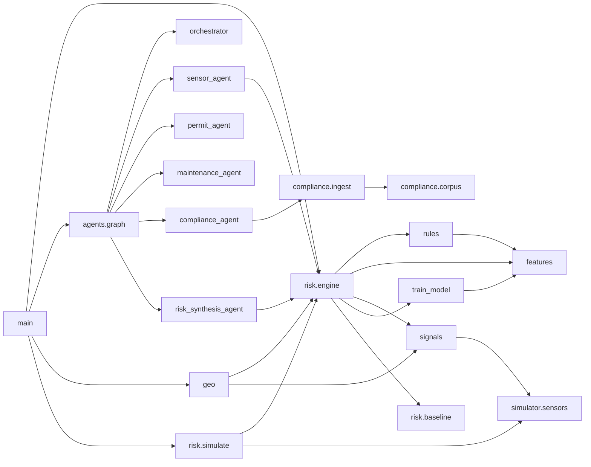

---

## 24. Key Takeaways

**What the project does:** Fuses sensor telemetry, work permits, maintenance records, and real regulatory text into a single explained risk score per plant zone, specifically engineered to detect *compound* risk — dangerous combinations that no single-sensor threshold could ever catch — with a live interactive simulator to prove that detection is real, not staged.

**Why it is valuable:** It directly targets the stated judging criterion (compound-risk detection vs. single-sensor baselines) with an architecture built around that metric from the ground up, not retrofitted onto a generic dashboard. Every score is explainable end-to-end — a genuine differentiator for a safety system, where "the model said so" is not an acceptable answer.

**Core technologies:** FastAPI + PostgreSQL/TimescaleDB/PostGIS on the backend; LangGraph for multi-agent orchestration; scikit-learn for the ML layer; ChromaDB + Gemini for retrieval-augmented regulatory grounding; React + deck.gl + MapLibre for the geospatial frontend.

**Major innovations:**
1. A hybrid rules+ML scorer where a hand-authored compound multiplier and an independently-trained ML model both have to agree something's dangerous — with rules deliberately weighted higher, keeping a safety system's decisions auditable.
2. A what-if simulator that shares its scoring code with the live path, turning "trust me, this works" into "watch it happen, live."
3. Cost- and quota-aware LLM integration (caching, model fallback, no-retry-on-quota) built *because* a real quota-exhaustion failure was hit and diagnosed, not designed defensively in the abstract.

**Architecture highlights:** A deliberate cheap/expensive endpoint split (poll the map for free, pay for reasoning only on click); a LangGraph topology whose parallel/sequential structure is derived entirely from genuine data dependencies (the Permit and Compliance Agents both depend on the Sensor Agent's output; the Maintenance Agent does not); graceful degradation at every external boundary (database down → 503, not a crash; LLM down → explicit "unavailable" signal, not fabricated text or a failed request).

**Main learning outcomes:** How to design an ML feature space and synthetic training data deliberately (including how it can silently encode blind spots — the rising-vs-plateaued bug is the clearest example); how to build and reason about a real multi-agent dependency graph rather than a linear script; how to integrate a third-party LLM API defensively (quotas, timeouts, fallbacks) rather than optimistically; and how spatial (PostGIS) and time-series (TimescaleDB) data modeling coexist in one relational database without needing separate specialized systems.

---

*Document generated from a direct, line-by-line reading of the current codebase (backend and frontend source, database schema, and configuration files) rather than from memory of earlier development sessions, to ensure every technical claim above is accurate as of the time this document was written.*
